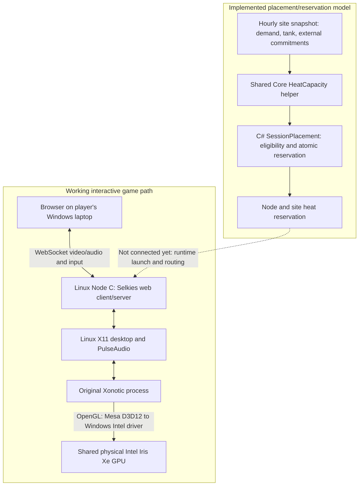
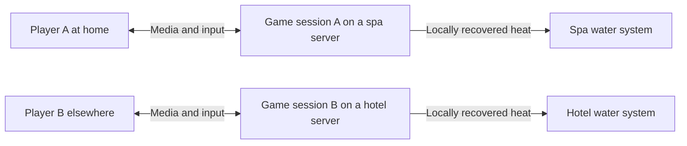

> T-40 update: [profile-driven C# launcher and webhosting retirement](gaming-profiles.md). The architecture below describes the heat-placement boundary; automatic reservation-to-launch integration remains pending.

# How the browser gaming prototype works

Current verified state, 2026-11-21. T-39, branch `featur-gaming`, PR #22. The user confirmed
Xonotic gameplay works through their browser. This guide describes what is implemented now;
[the lab log](gaming-lab.md) retains commands, experiments and limitations.

## 1. Two paths, with an integration boundary

The live game is manually launched by PowerShell. The C# reservation demo is separate. Reserving
a slot does not currently start a game, pause a batch job or redirect a browser. The dashed link
is the next integration task, not an existing control path.

## 2. What is on Windows and what is in Linux

Windows runs your browser, Docker Desktop, the physical Intel GPU driver, and the PowerShell
entry scripts. Docker Desktop's WSL2 Linux engine runs all session containers. The game and
Selkies execute inside Linux containers. The browser only receives media and sends input; the
original game is not installed in or rewritten for the browser. Ordinary website JavaScript is
downloaded as part of loading the page, with no client agent installation.

A, B and C are logical nodes on ONE laptop and Docker engine. They have separate containers,
ports, desktop homes and credentials, but share CPU, RAM, GPU, storage and the host failure domain.
Running two containers does not create two GPUs. The UI is bound to localhost for this trusted
lab; another computer or console cannot connect until a separately designed network/TLS and
session-authorization deployment is configured. Console-browser compatibility is not verified.

| Node | URL | Current role |
|---|---|---|
| A | http://localhost:18881 | Intel OpenGL desktop experiment, no game installation in its base image |
| B | http://localhost:18882 | Software-rendered desktop comparison |
| C | http://localhost:18883 | Original Xonotic on the derived graphics/game image |

## 3. What happens while you play

1. The browser authenticates to Selkies with Node C's local lab credentials.
2. Xonotic reads its original game assets in `/opt/Xonotic`, simulates the game, and renders into
   the Linux X11 desktop on display `:20`.
3. Mesa's D3D12 OpenGL driver translates rendering to D3D12. The read-only WSL driver mounts and
   `/dev/dxg` connect it to Windows' existing Intel driver and the physical Iris Xe.
4. Selkies captures the desktop, encodes video with CPU H.264, and sends it over WebSockets.
   PulseAudio provides the server-side audio path. Hardware video encoding was not established.
5. Your browser decodes the stream. Keyboard/mouse events return through Selkies into the Linux
   input path. Ctrl+Shift+X enables Gaming Mode; holding Escape for two seconds leaves it.

The experimental Mesa Dozen driver supplies Vulkan to Node C, and passed a cube smoke test.
Xonotic itself uses the verified OpenGL path; it does not depend on Dozen for rendering. The
Dozen experiment remains available, but is non-conformant/testing-only. It did not establish
CS2 compatibility. The Xonotic archive is the official unmodified 0.8.6 release, verified against
the publisher's SHA512. The source code and engine binary are not modified.

The image chain is pinned official Selkies desktop -> custom Dozen experiment -> Xonotic image.
The game's settings, home and logs live in C's persistent home volume. Image recreation preserves
that volume, but stops running processes: it is not a migration method for an active match.
The launcher runs as `ubuntu`, applies presentation settings from `xonotic-demo.json`, and uses
a process lock to prevent duplicate instances. A 30 FPS cap is a setting, not measured achieved FPS.
Keyboard/mouse gameplay is user-confirmed; a joystick initialization warning remains unresolved.

## 4. How heat-based placement works

There is one signal per site for one aligned UTC hour. Country and site metadata come from a
trusted inventory, not a client's claim. Each node also declares readiness, network eligibility
and allocatable session slots. Hotel/spa identifiers in the demo are synthetic; no live sensors,
real hotel heat profiles, site links or latency probes are configured.

For each site:

    available_heat_kwh = max(0,
        heat_demand_kwh + tank_capacity_kwh - tank_stored_kwh
        - external_committed_heat_kwh - allocator_owned_session_heat_kwh)

This is heat the site can consume immediately or store in the hour. A full tank can still absorb
current demand; a tank already full of hot water does not have more storage headroom.
`HeatCapacity.RemainingKwh` is shared with `GreedyHeatScheduler`, which uses the same numerator
to produce its load fraction. Placement ranks absolute remaining kWh: two sites can both have
a clipped 100% load target but different amounts of remaining useful heat capacity.

`SessionPlacement.TryReserve`:
1. Validates the request and checks whether its ID already has an identical held reservation.
2. Rejects new admission from a missing/expired inventory snapshot.
3. Filters locality through the existing `JobPlacement.IsEligible`, then requires enough useful
   heat capacity and a ready/network-eligible node with a free declared slot.
4. Chooses the site with the greatest remaining kWh; ties use stable site/node IDs.
5. Reserves node occupancy and site heat inside one lock. Concurrent requests cannot claim the
   same last slot, and multiple nodes at a spa cannot each reuse the entire spa reserve.

External heat commitments exclude claims held by this allocator. Allocatable node slots exclude
external workloads but INCLUDE this allocator's own claims, which are subtracted internally once.
Held session rates carry into subsequent accepted hourly snapshots until explicit release.
An existing reservation stays pinned after heat changes. A repeated ID with changed parameters
is rejected. If no site fits, the method returns no assignment; no queue or heat-dumping service
is implemented. These hourly estimates do not guarantee that an entire unknown-length match
will generate useful heat or that a GPU consumes a requested wattage.

The deterministic console example selects spa-a, hotel-a, spa-b, then home-a after home demand
rises. The first session stays on spa-a. Its per-session heat inputs are illustrative values,
not measurements of Xonotic or proof of physical node power capacity.

## 5. What distribution will mean

Players need not be physically at the heat site. Separate sessions and suitable batch jobs can
be placed on different servers; one original game process is not split across machines. New
sessions may follow summer heat demand to hotels/spas. Active matches retain their node; batch
work must yield resources first. Failure permits reconnect, not seamless recovery of game state.

The remaining runtime integration needs a launch/preemption adapter, observed resource release,
readiness before stream admission, session authorization and routing, and termination/restart
reconciliation. The reservation model is local and in-memory, so it is not an HA controller.
Real separate-engine nodes require authenticated remote agents and physical capacity accounting.
No Docker socket should be exposed to a customer desktop. The shared Network simulation added
by T-12 now exists on main; future adapters should coordinate with its site/forecast interfaces,
without replacing its model or creating a second physical/economic implementation.

## 6. Where to read the code

| Location | Responsibility |
|---|---|
| `gaming/DigitalHeat.Gaming.sln` | Visual Studio solution for the shared Core, gaming library, console demo and tests |
| `gaming/src/DigitalHeat.Gaming/GamingModels.cs` | Existing site, node, snapshot, request and reservation contracts |
| `gaming/src/DigitalHeat.Gaming/SessionPlacement.cs` | Validation, eligibility, ranking and synchronized accounting |
| `src/DigitalHeat.Core/HeatCapacity.cs` | Shared useful-heat capacity formula |
| `src/DigitalHeat.Core/Scheduling.cs` | Existing heat scheduler and executor interfaces |
| `gaming/demo/Program.cs` | Deterministic synthetic placement example |
| `gaming/tests/SessionPlacementTests.cs` | Placement and concurrency regression tests |
| `gaming/deploy/` | Compose definitions, image builds and demo settings |
| `gaming/scripts/GamingLab.Common.ps1` | Shared scoped Docker lookup and PS5.1-compatible HTTP checks |
| `gaming/scripts/Start-Xonotic.ps1` | Manual game launch, working directory, audio environment and lock |
| `gaming/TestResults/` | Ignored local credentials, diagnostics and run evidence |

Open `gaming/DigitalHeat.Gaming.sln` in Visual Studio to navigate the code. It builds with zero warnings/errors. Existing CLI commands remain available. Read-only checks from the gaming checkout:

    dotnet run --project gaming/demo
    dotnet test gaming/tests
    .\gaming\scripts\Test-GamingLab.ps1
    .\gaming\scripts\Test-DozenDesktop.ps1
    .\gaming\scripts\Test-Xonotic.ps1

Use the existing startup commands in gaming-lab.md when a desktop is stopped. Do not rerun
startup/recreation against an active match as a health check. The cleanup did not restart any
container or game process. Runtime launches, accounts and credentials were not reset.

## 7. Cleanup verification

Data records were moved without changing constructors or field names. Snapshot validation and
candidate enumeration now have named methods; locking, ordering and reservation behavior are
unchanged. Shared PowerShell helpers replace repeated label lookup and HTTP authentication code.
HTTP checks now work on Windows PowerShell 5.1 as well as PowerShell 7; the ordinary lab check
uses a practical request timeout while startup polling retains its explicit short timeout.
PS5.1 table output uses proper objects instead of selecting columns from hashtables.

Verified after cleanup: 14 gaming tests, 40 Core tests, unchanged synthetic assignment sequence,
A/B anonymous 401 and authenticated 200, C anonymous 401 and authenticated 200, original Xonotic
process and Intel renderer still present. Script parsing and whitespace checks pass. Live browser
playability was confirmed by the user before cleanup; no layout or gameplay behavior was changed.
