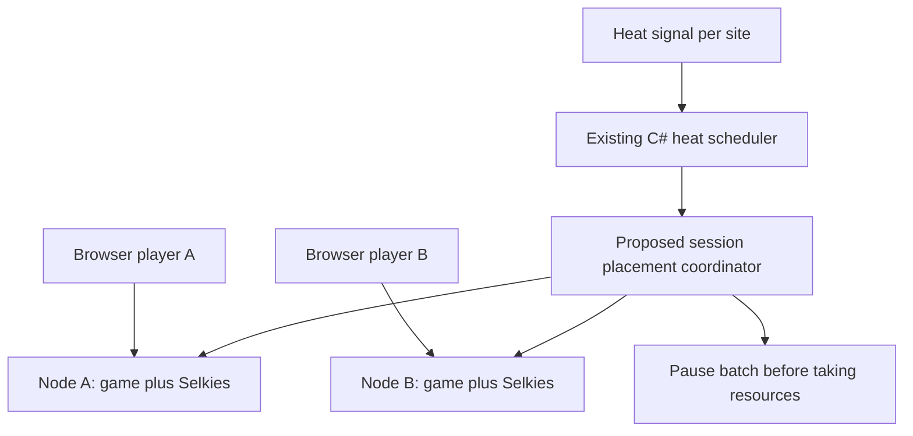
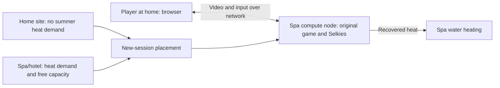

# Browser gaming lab (T-39)

Status 2026-11-21: compatibility experiment, two healthy Linux Selkies desktops. Code branch
featur-gaming. User approved browser clients, Selkies, multi-server placement and protecting active
matches. Session coordinator and CS2 support are not implemented at this milestone.

## Run and test on Windows

Use the gaming checkout (currently C:\Users\nikit\Documents\ETH\HackathonSprintd-gaming):

    .\gaming\scripts\Start-GamingLab.ps1 -Pull -IntelWsl
    .\gaming\scripts\Test-GamingLab.ps1
    .\gaming\scripts\Test-SessionGraphics.ps1 -Node session-a

Open http://localhost:18881 for A or http://localhost:18882 for B. Username player; generated
password_a/password_b are in gaming/TestResults/credentials.json. That directory is git-ignored;
never commit its credentials, game accounts or personal files. Do not expose these ports publicly.
Only loopback HTTP is configured; public deployment requires proper TLS and session authorization.
The container operator can inspect session data. Clipboard/files/mic/webcam/printing are disabled
in the supplied configuration. No Docker socket or privileged mode is given to the desktops.

Stop without deleting homes:

    .\gaming\scripts\Stop-GamingLab.ps1

Omit -IntelWsl to recreate A in software mode. B always remains the software comparison.
Each startup restores generated credentials from the local file, pins the image digest from
image.txt, and waits for both nodes' authentication challenges. Default 1280x720 at 20 FPS,
2 CPU equivalents and 3 GiB RAM per desktop are lab limits, not measured performance claims.

## Verified and unverified

Official image digest: sha256:5e877dfc8280afc2326bb24a3a57d37d2edb081e595014842aff1d6cd3569015,
Selkies reports version 2.2.1, Ubuntu 26.04. WebSockets is its default transport; WebRTC is optional.
Docker Desktop 4.94.0, Linux engine 29.8.2, WSL2; Windows Intel Iris Xe driver 31.0.101.4146.

- Both containers healthy; anonymous HTTP 401, authenticated HTML 200. Separate home volumes
  and localhost-only ports checked. These checks do not establish browser video/input.
- Browser automation unavailable in this chat. User supplied a screenshot of the streamed desktop and confirmed keyboard/input work on 2026-11-21. This verifies the user-observed desktop path, not CS2 gameplay or measured latency.
- Software baseline: OpenGL llvmpipe, Accelerated no; Vulkan CPU llvmpipe.
- Intel experiment: map /dev/dxg, mount /usr/lib/wsl/lib AND /usr/lib/wsl/drivers read-only,
  set LD_LIBRARY_PATH, GALLIUM_DRIVER=d3d12 and Intel adapter selection. Actual glxinfo -B
  and surfaceless eglinfo identify D3D12 (Intel Iris Xe), Accelerated yes, OpenGL 4.1.
  Missing the drivers mount initially caused EGL failure and an X display restart; fixed.
- VAAPI d3d12 initialization fails on the current X11 path. Hardware video encoding unverified.
  CPU encoding deliberately selected. A two-second 1280x720 X11 capture encoded with libx264
  and ffmpeg exited 0: `docker exec --user ubuntu --env DISPLAY=:20 digitalheat-gaming-session-a-1
  ffmpeg -hide_banner -loglevel error -f x11grab -video_size 1280x720 -framerate 10 -i :20
  -t 2 -c:v libx264 -preset ultrafast -f null -`.
- Vulkan enumerates only llvmpipe CPU; this image has no dzn Vulkan ICD. Accelerated OpenGL
  does not imply Vulkan support. CS2 has not been downloaded/launched; no FPS/latency claim.
- Planned node-stop isolation check was blocked by execution policy before execution. No
  fault-isolation claim is made; both nodes remain running and healthy.

Raw reports stay in gaming/TestResults (ignored). Device access probes are a lab experiment,
not a security boundary. Host Intel driver updates or compiling Mesa have not been performed.

## How work is split between servers

Current A/B containers share one outer Docker engine, laptop and Intel GPU. They demonstrate
separate session homes and endpoints, not separate physical capacity or fault domains. No
single unmodified game process is split between machines. A future node agent/adapter uses
independent remote engines through authenticated control, never unauthenticated Docker TCP.

The proposed coordinator filters readiness, locality and free session capacity; uses the shared
scheduler output to rank heat preference; atomically claims a slot; confirms batch pause and
resource release; launches/adopts the session; then keeps active placement fixed. Reject/rollback
on failed preemption or launch. Reconcile existing sessions after controller restart before new
admission. Hardware inventory must avoid double-counting a GPU shared by several containers.

User decision pending: reject new sessions when every eligible site's heat target is zero, or
allow them and explicitly report unused heat. Active sessions keep running either way. Do not
implement this policy implicitly. Session failure allows reconnect; game progress persistence
is game-specific. Existing webhosting request-routing does not migrate game state or UDP flows.

## Next gates

1. User browser stream/input smoke check.
2. Choose between a software-demo fallback, an explicitly scoped Vulkan driver experiment, or
   a compatible remote/native-Linux GPU host for real CS2. Each has different cost/scope.
3. Implement reviewed session allocation and observed batch preemption after zero-heat policy
   is chosen. Coordinate with T-11/T-12 and existing runtime, without duplicating heat formulas.

Sources checked 2026-11-21: https://docs.selkies.io/latest/start/,
https://docs.selkies.io/latest/settings/, https://docs.mesa3d.org/drivers/d3d12.html,
https://devblogs.microsoft.com/commandline/d3d12-gpu-video-acceleration-in-the-windows-subsystem-for-linux-now-available/.
Decision: decisions/0021-selkies-gaming-lab.md, fresh-context verdict go with changes.

## User-confirmed browser test and summer placement (2026-11-21)

User supplied an actual browser screenshot and reported working keyboard/input. Browser desktop
smoke is now user-verified. The screenshot's black wallpaper area looked mis-sized. Requested
PCManFM-Qt wallpaper mode stretch live on A; it accepted/persisted the setting without restarting
the session. Visual correction awaits user confirmation. Repeat if needed:

    .\gaming\scripts\Repair-SessionWallpaper.ps1 -Node session-a

Summer policy clarification: the gamer and compute/heat site are distinct. A gamer at home can
stream a game executing at a hotel/spa where hot water is needed, even if no hotel guests game.
Place NEW sessions on ready, locality-permitted nodes with real capacity and useful heat demand;
also enforce measured network reachability/latency eligibility. Geography/site type alone does
not establish low latency or useful heat. There must be provisioned computing hardware and a
working heat-recovery system at that site. Do not invent a hotel/spa heat profile or hardware.
The laptop lab will use explicitly synthetic home/hotel/spa signals until sourced data exists.

Existing sessions retain their node until session end, even if heat preference changes; batch
work is preempted first, with observed release before new-session launch. Subsequent sessions
can move to hotels/spas. This is placement of compute before admission, not transport of heat
between buildings or live game-state migration. Batch work can be checkpointed/requeued only
where its declared executor supports it. If every eligible site lacks useful heat or capacity,
the system cannot guarantee useful heat: user choice between waiting/rejection and explicit
waste-heat operation remains pending. The user's hotel/spa answer resolves preferred remote
placement but does not specify this exhausted-capacity fallback.

Controller implementation remains pending; these paragraphs record agreed behavior and test
requirements, not completed remote-node orchestration. GPU/Vulkan/CS2 gates remain unchanged.

## Case-source clarification: available heat reserve (2026-11-21)

User requests choosing the server whose infrastructure has the largest available heat reserve.
Read the live sprintd case page (URL below); its summer use case explicitly permits moving jobs
to hotels, spas, agriculture or businesses with heat demand. It does not define a ranking metric
called reserved heat. Proposed interpretation awaiting confirmation: remaining useful heat
absorption capacity over the next one-hour interval, not the amount of heat already in storage.

available_heat_capacity_kwh = max(0, demand_kwh + tank_capacity_kwh - tank_stored_kwh
    - already_committed_recoverable_heat_kwh).

All terms must refer to the same site and interval. Commitments include running sessions and
other scheduled heat sources; track them once per site, not once independently for every node.
Rank eligible sites by this remaining amount; then choose a ready node with free compute capacity
within the site, with stable ID ties. Recheck and reserve compute plus thermal capacity atomically.
Do not count the full site reserve for every simultaneous admission. Existing shared heat
scheduler supplies the demand/storage-based load target, but its clipped 0..1 return alone cannot
rank absolute capacity after saturation. Any needed shared interface extension must be coordinated
with T-11/T-12 and reviewed before implementation; do not copy the thermal model into gaming.

A full tank has zero storage headroom, but current demand can still absorb heat. When every site's
reserve is zero, descending ranking alone supplies no meaningful winner: queue versus explicit
waste-heat execution remains a fallback choice. No queue/waste policy is silently inferred.

Source accessed 2026-11-21:
https://app.sprintd.org/events/sprintd-basel-greentech/cases/useful-load-useful-heat-can-your-computing-power-heat-a-home

## Implemented heat-capacity reservation demo

The user confirmed the available-capacity interpretation. The shared core now factors the
existing GreedyHeatScheduler numerator into HeatCapacity.RemainingKwh. The gaming reservation
model calls that helper, so the heat formula is shared with the yearly scheduler. Valid legacy
scheduler output is regression-checked. No new thermal or economic scenario is substituted.

From the gaming checkout:

    dotnet run --project gaming/demo
    dotnet test gaming/tests

The fixed synthetic demo has home capacity 0.5 kWh, hotel capacity 2 + 4 - 3 = 3 kWh, and spa
capacity 3 + 2 - 1 = 4 kWh for the hour. Each illustrative session reserves 2 kWh/hour, NOT a
measured gaming rate. Player 1 selects spa-a (4 available), player 2 selects hotel-a (3 available
versus spa's remaining 2), player 3 selects spa-b (remaining 2). Raising home demand to 5 kWh
places player 4 at home-a. Player 1 remains on spa-a. JSON output is snake_case.

This demonstrates that two servers at a spa SHARE the site's thermal reserve. An admission
atomically claims one node slot and its recoverable heat amount. Request-ID retries are
idempotent; changing a request under an existing ID fails. Readiness, network eligibility and
T-24 locality filter candidates before ranking. Equal reserves use stable site/node IDs.
Current UTC-hour snapshots require increasing revisions. External committed heat excludes
claims already owned by this coordinator. Allocatable slots exclude external workloads but
include this coordinator's held slots, which are subtracted internally exactly once. Held
per-hour heat rates carry into the next interval and are released only by explicit caller action
following observed termination (or cancellation of an unlaunched claim).

If no site can absorb the declared request heat with available compute slots, TryReserve returns
no assignment. There is no automatic waste-heat placement or queue service. Sessions already
held remain pinned after demand or inventory changes. The component is in-memory and local;
restart reconciliation/durable ownership must precede actual game launching. No automatic
Selkies routing, batch pause or game execution is claimed by this console demo. Independent
remote-engine control remains an adapter integration task, not delivered by two local desktops.
