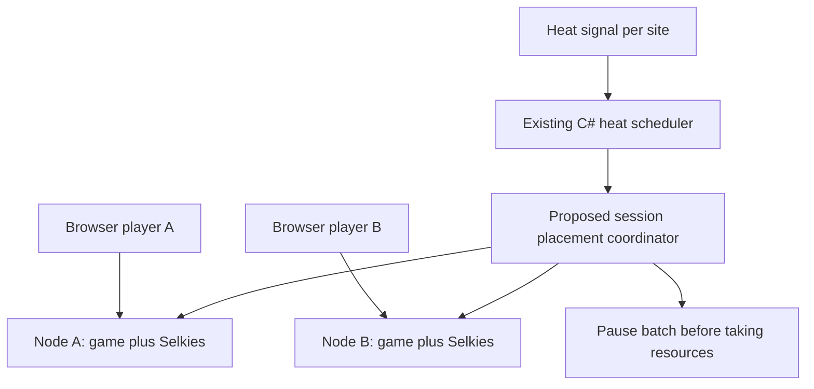

# Browser gaming lab (T-39)

Status 2026-11-21: compatibility experiment, two healthy Linux Selkies desktops. Code branch
featur-gaming. User approved browser clients, Selkies, multi-server placement and protecting active
matches. Session coordinator and CS2 support are not implemented at this milestone.

## Run and test on Windows

Use the gaming checkout (currently C:\Users\nikit\Documents\ETH\HackathonSprintd-gaming):

    .\gaming\scripts\Start-GamingLab.ps1 -Pull -IntelWsl
    .\gaming\scripts\Test-GamingLab.ps1
    .\gaming\scripts\Test-SessionGraphics.ps1 -Node session-a

Open http://localhost:18881 for A or http://localhost:18882 for B. Username player; generated
password_a/password_b are in gaming/TestResults/credentials.json. That directory is git-ignored;
never commit its credentials, game accounts or personal files. Do not expose these ports publicly.
Only loopback HTTP is configured; public deployment requires proper TLS and session authorization.
The container operator can inspect session data. Clipboard/files/mic/webcam/printing are disabled
in the supplied configuration. No Docker socket or privileged mode is given to the desktops.

Stop without deleting homes:

    .\gaming\scripts\Stop-GamingLab.ps1

Omit -IntelWsl to recreate A in software mode. B always remains the software comparison.
Each startup restores generated credentials from the local file, pins the image digest from
image.txt, and waits for both nodes' authentication challenges. Default 1280x720 at 20 FPS,
2 CPU equivalents and 3 GiB RAM per desktop are lab limits, not measured performance claims.

## Verified and unverified

Official image digest: sha256:5e877dfc8280afc2326bb24a3a57d37d2edb081e595014842aff1d6cd3569015,
Selkies reports version 2.2.1, Ubuntu 26.04. WebSockets is its default transport; WebRTC is optional.
Docker Desktop 4.94.0, Linux engine 29.8.2, WSL2; Windows Intel Iris Xe driver 31.0.101.4146.

- Both containers healthy; anonymous HTTP 401, authenticated HTML 200. Separate home volumes
  and localhost-only ports checked. These checks do not establish browser video/input.
- Browser automation unavailable in this chat. User has been asked to verify video, keyboard
  and mouse through the actual browser. No successful end-to-end stream claim yet.
- Software baseline: OpenGL llvmpipe, Accelerated no; Vulkan CPU llvmpipe.
- Intel experiment: map /dev/dxg, mount /usr/lib/wsl/lib AND /usr/lib/wsl/drivers read-only,
  set LD_LIBRARY_PATH, GALLIUM_DRIVER=d3d12 and Intel adapter selection. Actual glxinfo -B
  and surfaceless eglinfo identify D3D12 (Intel Iris Xe), Accelerated yes, OpenGL 4.1.
  Missing the drivers mount initially caused EGL failure and an X display restart; fixed.
- VAAPI d3d12 initialization fails on the current X11 path. Hardware video encoding unverified.
  CPU encoding deliberately selected. A two-second 1280x720 X11 capture encoded with libx264
  and ffmpeg exited 0: `docker exec --user ubuntu --env DISPLAY=:20 digitalheat-gaming-session-a-1
  ffmpeg -hide_banner -loglevel error -f x11grab -video_size 1280x720 -framerate 10 -i :20
  -t 2 -c:v libx264 -preset ultrafast -f null -`.
- Vulkan enumerates only llvmpipe CPU; this image has no dzn Vulkan ICD. Accelerated OpenGL
  does not imply Vulkan support. CS2 has not been downloaded/launched; no FPS/latency claim.
- Planned node-stop isolation check was blocked by execution policy before execution. No
  fault-isolation claim is made; both nodes remain running and healthy.

Raw reports stay in gaming/TestResults (ignored). Device access probes are a lab experiment,
not a security boundary. Host Intel driver updates or compiling Mesa have not been performed.

## How work is split between servers

Current A/B containers share one outer Docker engine, laptop and Intel GPU. They demonstrate
separate session homes and endpoints, not separate physical capacity or fault domains. No
single unmodified game process is split between machines. A future node agent/adapter uses
independent remote engines through authenticated control, never unauthenticated Docker TCP.

The proposed coordinator filters readiness, locality and free session capacity; uses the shared
scheduler output to rank heat preference; atomically claims a slot; confirms batch pause and
resource release; launches/adopts the session; then keeps active placement fixed. Reject/rollback
on failed preemption or launch. Reconcile existing sessions after controller restart before new
admission. Hardware inventory must avoid double-counting a GPU shared by several containers.

User decision pending: reject new sessions when every eligible site's heat target is zero, or
allow them and explicitly report unused heat. Active sessions keep running either way. Do not
implement this policy implicitly. Session failure allows reconnect; game progress persistence
is game-specific. Existing webhosting request-routing does not migrate game state or UDP flows.

## Next gates

1. User browser stream/input smoke check.
2. Choose between a software-demo fallback, an explicitly scoped Vulkan driver experiment, or
   a compatible remote/native-Linux GPU host for real CS2. Each has different cost/scope.
3. Implement reviewed session allocation and observed batch preemption after zero-heat policy
   is chosen. Coordinate with T-11/T-12 and existing runtime, without duplicating heat formulas.

Sources checked 2026-11-21: https://docs.selkies.io/latest/start/,
https://docs.selkies.io/latest/settings/, https://docs.mesa3d.org/drivers/d3d12.html,
https://devblogs.microsoft.com/commandline/d3d12-gpu-video-acceleration-in-the-windows-subsystem-for-linux-now-available/.
Decision: decisions/0021-selkies-gaming-lab.md, fresh-context verdict go with changes.
