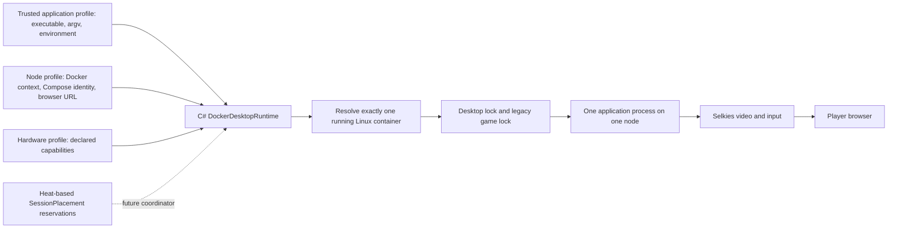

# Reusable gaming runtime profiles (T-40)

The working browser demo now has a C# application launcher driven by
`gaming/deploy/runtime-profiles.json`. This is a prototype for already provisioned Linux
streaming desktops. It does not yet automatically launch SessionPlacement reservations.



## Configuration and boundaries

- Applications define executable, Linux working directory/user, log, arguments, named variants,
  environment and required capabilities. Xonotic's presentation settings are here, replacing
  `xonotic-demo.json`: window 1280×720, 30 FPS limit, optional stormkeep map with two bots.
  These are chosen demo settings, not measured performance or heat output.
- Nodes define Docker context, exact Compose project/service, browser URL and hardware profile.
  The checked-in three nodes use `desktop-linux`, the same local Docker Desktop engine. A/B do
  not declare Xonotic installed; selecting them for Xonotic is rejected before Docker dispatch.
- Runtime hardware profiles describe declared compatibility. They are separate from the team's
  sourced economic/energy profiles in `config/hardware`; no second heat model is introduced.
  Operators must match declarations to the deployed image and actual rendering probes. The
  profile is not automatic GPU discovery or proof that CPU/RAM/GPU capacity is free.
- Compose still provisions containers, image, CPU/RAM limits, devices, port and home volumes.
  NVIDIA needs an NVIDIA-capable Linux node, approved runtime/toolkit configuration and verified
  rendering/encoding. Adding a capability name alone does not install drivers or provide a GPU.
- Remote nodes can select existing authenticated Docker contexts, with reachable browser URLs.
  No new remote engine, remote stream path, latency bound or multi-engine fault tolerance has
  been tested. Do not expose Docker sockets or unauthenticated TCP endpoints to desktops.

Profiles are trusted operator code configuration, not tenant input. They can execute programs
already in the container. Keep credentials and personal data out of them; plan output includes
argv and environment. JSON rejects unknown fields; IDs/references, absolute paths, environment
names and declared compatibility are validated before dispatch. Values in the fixed inner
Linux shell are quoted literally. The selected application runs as the configured non-root
user; operators remain responsible for the container's Unix account mapping.

The adapter uses `ProcessStartInfo.ArgumentList`, explicit Docker context and exact Compose
label filters. It rejects missing or ambiguous containers. A 30-second lab timeout bounds each
Docker control call. Both `/tmp/digitalheat-desktop.lock` and the legacy Xonotic lock are held
for the application's lifetime. They prevent duplicate/cooperative launches within this
desktop, including the game started before this refactor. They are not durable distributed
leases, an authorization system or a guarantee against programs started outside the launcher.

Detached Docker exec acknowledgment is **not readiness**: an occupied desktop, missing binary
or failed game may still return an acknowledgment before the child exits. Check the log and
browser; no heat reservation is created/released by this tool. There is deliberately no stop,
pause or migrate operation against an active match.

## Commands from the repository root

Read-only plan (Docker lookup only, no application launch):

```powershell
.\gaming\scripts\Start-Application.ps1 -Application xonotic -Node session-c -Variant match -PlanOnly
```

Existing launch command still works and now delegates to the C# adapter:

```powershell
.\gaming\scripts\Start-Xonotic.ps1 -StartMatch
.\gaming\scripts\Test-Xonotic.ps1
```

Open http://localhost:18883 with the existing local credentials. Do not paste credentials into
profiles or commit ignored `gaming/TestResults`. Start/recreate Node C with
`Start-DozenDesktop.ps1 -Xonotic` only when its existing session can be interrupted.

For a different trusted application/configuration:

```powershell
.\gaming\scripts\Start-Application.ps1 -Profiles C:\path\profiles.json -Application other-app -Node other-node -PlanOnly
```

The original game process stays entirely on its assigned node. Multiple sessions can run on
different eligible nodes once they have the game image and the reservation/runtime coordinator
is implemented. A single original game is not divided across machines. Input does not have to
originate at the heat site: new sessions can eventually be placed at a hotel/spa by the existing
heat ranking, subject to placement policy and verified network/resource eligibility.

## Code and verification

`gaming/src/DigitalHeat.Gaming/RuntimeProfiles.cs` defines/validates configuration.
`DockerDesktopRuntime.cs` is the replaceable Docker adapter; `IDockerCommandRunner` isolates
process I/O for tests. `gaming/runtime` is the console entry point in the gaming VS solution.
`Start-Application.ps1` works on Windows PowerShell 5.1; `Start-Xonotic.ps1` is its compatibility
wrapper. Existing `IContainerControl` remains batch pause/throttle control; it was not expanded
into a game lifecycle interface.

```powershell
dotnet build gaming/DigitalHeat.Gaming.sln
dotnet test gaming/tests
dotnet test src/DigitalHeat.Core.Tests
.\gaming\scripts\Test-ApplicationRuntime.ps1
```

The offline smoke requires an existing local `alpine:3.22` image (or `-Image` with compatible
Linux tools). It creates only its own temporary, network-disabled, resource-limited container,
tests argument round-trip without shell execution and legacy-lock exclusion, then removes it.
It does not run against the player's desktop.

Verified: 21 gaming tests and 41 Core tests pass; gaming solution builds with zero warnings/errors;
PS5.1 read-only Node C plan and backward-compatible launch dispatch pass; original Xonotic PID
403 remains unchanged, Intel OpenGL/assets/audio checks pass. A/B/C anonymous HTTP 401 and
authenticated HTTP 200 remain correct. Gameplay was user-verified before the change, not newly
observed by automated tests. No real heat, remote GPU, NVIDIA encode or CS2 result is implied.

## Webhosting retirement

User withdrew the webhosting feature. Its tracked solution, controller, gateway, node,
contracts, samples, tests, Compose and scripts are removed in PR #22. Exact old Compose projects
`webhosting-scheduler`, `webhosting-isolation`, `webhosting-monitors`, `webhosting-ingress` and
`webhosting-engines` were inspected by label and their containers and unused networks removed. Gaming containers
were left running. No global Docker prune, volume/image deletion or unrelated project cleanup.
Other worktrees and Visual Studio state were preserved.

Old webhosting docs and ADRs remain as historical engineering evidence with retirement notices;
their commands describe removed code and must not be used as current setup instructions.
T-23/T-27/T-36 are retired. Shared Core/JobRuntime, team network simulation and hardware research
contracts remain because they serve other workloads. This is not a change to the team's business
model or the scored reference house.

Integration complete: PR #22 merged as `56501a7`; withdrawn hosting PRs #12 and #19 closed. T-39/T-40 finished, ADR 0026 reviewed with changes; team ADR acceptance remains pending.
