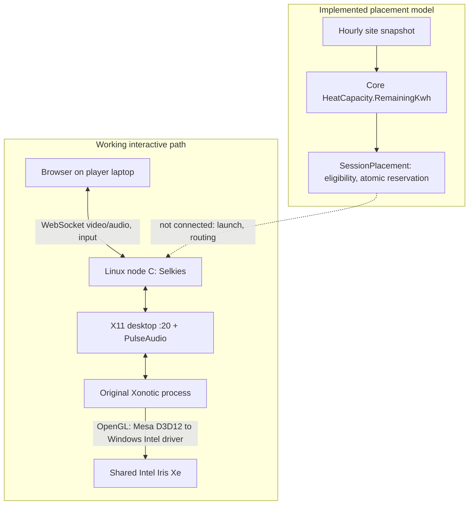

# Browser gaming prototype (historical T-39, T-40)

**Current 2026-11-21:** user retired the CS/Xonotic/Dozen labs. Keep Minecraft server + Node A client only. See [presentation cleanup](jobs/presentation-cleanup.md). The original prototype description below is historical; removed game scripts are no longer runnable.

Status 2026-11-21: working prototype, merged in PR #22 (`56501a7`). Original, unmodified Xonotic
0.8.6 runs on a Linux desktop container and is streamed to a browser with Selkies; the user
confirmed keyboard/mouse gameplay. A separate C# model reserves heat capacity per site. The two
are **not connected yet**: reserving a slot does not launch a game, pause a batch job or route a
browser. CS2 is deferred and unverified. This is a user-requested experiment, separate from the
team business model and the scored reference house. (A webhosting feature was retired earlier,
decision 0026.)

Decisions: 0021 (Selkies lab), 0022 (heat-capacity reservation), 0023 (isolated Dozen build),
all reviewed "go with changes"; team acceptance pending. Ticket: `tickets/T-39-intel-browser-gaming.md`.

## 1. Architecture

- Windows hosts the browser, Docker Desktop (WSL2 Linux engine), the Intel driver and the
  PowerShell scripts. Game and Selkies run in Linux containers. The browser installs nothing.
- Nodes A, B, C are logical nodes on ONE laptop, engine and GPU: separate containers, ports, homes
  and credentials, but shared CPU, RAM, GPU and failure domain. They are not separate capacity.
- UI is bound to localhost only; public deployment needs separate TLS and session authorization.
  Console-browser compatibility is not verified.

| Node | URL | Role |
|---|---|---|
| A | http://localhost:18881 | Intel OpenGL desktop experiment, no game |
| B | http://localhost:18882 | Software-rendered comparison |
| C | http://localhost:18883 | Original Xonotic on the derived Dozen/game image |

**Play path.** Browser authenticates to Selkies; Xonotic reads assets in `/opt/Xonotic` and renders
to display `:20`; Mesa D3D12 OpenGL reaches the Intel driver through `/dev/dxg` and read-only
mounts of `/usr/lib/wsl/lib` and `/usr/lib/wsl/drivers`; Selkies encodes with CPU H.264 (hardware
encoding not established: VAAPI d3d12 init fails) and streams over WebSockets (default transport;
WebRTC optional). Ctrl+Shift+X enables Selkies Gaming Mode, hold Escape 2 s to leave
(https://docs.selkies.io/latest/usage/). Image chain: pinned official Selkies desktop -> Dozen
experiment -> Xonotic image. Recreating the image keeps C's home volume but kills running
processes; it is not a migration method for an active match.

**Isolation.** Clipboard, files, microphone, webcam and printing disabled; no Docker socket or
privileged mode for desktops. Device-access probes are a lab experiment, not a security boundary.
The container operator can see session data. Never commit `gaming/TestResults/` (credentials).

## 2. Heat-based placement model

One signal per site per aligned UTC hour; site/country metadata from a trusted inventory. Nodes
declare readiness, network eligibility and allocatable session slots. Hotel/spa/home sites in the
demo are synthetic; no real heat profiles, sensors, hardware or latency probes exist.

Interpretation confirmed by the user, from the case page (summer use case allows moving jobs to
hotels, spas, agriculture, businesses; it defines no ranking metric). Source accessed 2026-11-21:
https://app.sprintd.org/events/sprintd-basel-greentech/cases/useful-load-useful-heat-can-your-computing-power-heat-a-home

    available_heat_kwh = max(0, heat_demand_kwh + tank_capacity_kwh - tank_stored_kwh
        - external_committed_heat_kwh - allocator_owned_session_heat_kwh)

All terms refer to the same site and hour. A full tank has zero storage headroom but current demand
still absorbs heat. `HeatCapacity.RemainingKwh` is shared with `GreedyHeatScheduler` (same
numerator); the gaming model does not copy the thermal model. The scheduler's clipped 0..1 load
fraction alone cannot rank sites after saturation, so placement ranks absolute remaining kWh.

`SessionPlacement.TryReserve`:
1. Validate the request; an identical repeated request ID is idempotent, a changed one fails.
2. Reject if the inventory snapshot is missing/expired (snapshots need increasing revisions).
3. Filter by locality (`JobPlacement.IsEligible`, T-24), then require enough heat capacity and a
   ready, network-eligible node with a free slot.
4. Pick the site with most remaining kWh; ties by stable site/node ID.
5. Claim node slot and site heat atomically under one lock, so two nodes at a spa share the spa's
   reserve and concurrent requests cannot take the same last slot.

External commitments exclude this allocator's claims; allocatable slots exclude external workloads
but include this allocator's held slots (subtracted once). Held heat rates carry into later hourly
snapshots until the caller releases them after observed termination (or cancels an unlaunched
claim). Existing sessions stay pinned to their node whatever the heat does; batch work is
preempted first, with observed release before a new launch. If nothing fits, `TryReserve` returns
no assignment: there is no queue and no automatic waste-heat mode. **Open user decision:** reject
or wait versus run and report unused heat when every eligible site has zero capacity.

Synthetic demo (`dotnet run --project gaming/demo`, JSON in snake_case): home 0.5 kWh, hotel
2 + 4 - 3 = 3 kWh, spa 3 + 2 - 1 = 4 kWh; each session reserves an illustrative 2 kWh/h (NOT a
measured gaming rate). Players 1-3 go to spa-a, hotel-a, spa-b; raising home demand to 5 kWh sends
player 4 to home-a; player 1 stays on spa-a.

**Distribution semantics.** The player need not be at the heat site: a home player can stream a
session running at a hotel/spa. This is placement of compute before admission, not transport of
heat or live migration of game state. One original game process is never split across machines.
Batch work can be checkpointed/requeued only where its executor supports it. Session failure allows
reconnect, not recovery of game state. Geography does not establish low latency or useful heat;
a site needs provisioned hardware, a working heat-recovery system and measured reachability.

**Not yet built.** Launch/preemption adapter, observed resource release, readiness before stream
admission, session authorization and routing, termination/restart reconciliation, durable
ownership (the model is in-memory, not an HA controller), authenticated remote node agents
(never unauthenticated Docker TCP), and GPU inventory that avoids double-counting a shared GPU.
Coordinate with T-11/T-12 (Network simulation on main) and do not create a second heat model.

## 3. Runtime profiles (T-40)

`gaming/deploy/runtime-profiles.json` drives a C# launcher (`RuntimeProfiles.cs`,
`DockerDesktopRuntime.cs`, console `gaming/runtime`), replacing `xonotic-demo.json`.
- **Applications:** executable, Linux user/working directory, log, argv, named variants,
  environment, required capabilities. Xonotic: 1280x720, 30 FPS cap, optional stormkeep map with two
  bots (chosen demo settings, not measured performance or heat).
- **Nodes:** Docker context, exact Compose project/service, browser URL, hardware profile. The
  three checked-in nodes use the local `desktop-linux` engine. A/B do not declare Xonotic;
  selecting them is rejected before dispatch.
- **Hardware profiles** are declared compatibility, separate from the sourced profiles in
  `config/hardware`; not GPU discovery nor proof of free capacity. Compose still provisions
  image, CPU/RAM limits, devices, ports and volumes. NVIDIA would need an NVIDIA-capable Linux
  node and verified rendering/encoding; none was tested.
- **Safety:** profiles are trusted operator config (plan output shows argv/environment; keep
  secrets out). JSON rejects unknown fields; references, absolute paths and env names are
  validated; the adapter uses `ArgumentList`, explicit Docker context, exact label filters and
  rejects missing/ambiguous containers; 30 s timeout per Docker call. Locks
  `/tmp/digitalheat-desktop.lock` and the legacy Xonotic lock guard against duplicate cooperative
  launches only (not leases or authorization).
- Detached exec acknowledgment is **not readiness**; check the log and browser. No heat reservation
  is created or released, and there is deliberately no stop/pause/migrate on an active match.
  `IContainerControl` stays batch-only.

## 4. Run and test (Windows, from the gaming checkout)

Currently `C:\Users\nikit\Documents\ETH\HackathonSprintd-gaming`, branch `featur-gaming`.

    .\gaming\scripts\Start-GamingLab.ps1 -Pull -IntelWsl     # A (Intel) and B (software)
    .\gaming\scripts\Test-GamingLab.ps1
    .\gaming\scripts\Test-SessionGraphics.ps1 -Node session-a
    .\gaming\scripts\Stop-GamingLab.ps1                      # keeps homes

Omit `-IntelWsl` to recreate A in software mode. Username `player`; generated passwords
(`password_a`, `password_b`) are in `gaming/TestResults/credentials.json` (git-ignored). Startup
restores credentials, pins the image digest from `image.txt` and waits for both auth challenges.
Defaults 1280x720, 20 FPS, 2 CPU, 3 GiB RAM per desktop are lab limits, not measurements.

Node C with Xonotic (credentials in `gaming/TestResults/dozen-credentials.json`, user `player`):

    .\gaming\scripts\Build-DozenExperiment.ps1
    .\gaming\scripts\Test-DozenExperiment.ps1 [-RenderSmoke | -FullReport]
    .\gaming\scripts\Build-Xonotic.ps1
    .\gaming\scripts\Start-DozenDesktop.ps1 -Xonotic         # recreates only C; keeps its home
    .\gaming\scripts\Start-Application.ps1 -Application xonotic -Node session-c -Variant match -PlanOnly
    .\gaming\scripts\Start-Xonotic.ps1 [-StartMatch]         # delegates to the C# adapter
    .\gaming\scripts\Test-Xonotic.ps1
    .\gaming\scripts\Test-DozenDesktop.ps1                   # login diagnostic (200/401)
    .\gaming\scripts\Test-SessionGraphics.ps1 -Node session-c
    .\gaming\scripts\Repair-SessionWallpaper.ps1 -Node session-a
    .\gaming\scripts\Stop-DozenDesktop.ps1                   # keeps home
    .\gaming\scripts\Show-VulkanCube.ps1
    .\gaming\scripts\Test-ApplicationRuntime.ps1             # offline smoke, needs local alpine:3.22

A custom profile file: `Start-Application.ps1 -Profiles C:\path\profiles.json -Application <app>
-Node <node> -PlanOnly`. If Xonotic already runs, quit it from its menu before `-StartMatch`.
Never recreate or restart a node as a health check while a real match is active.

Code and tests:

    dotnet build gaming/DigitalHeat.Gaming.sln
    dotnet run --project gaming/demo
    dotnet test gaming/tests
    dotnet test src/DigitalHeat.Core.Tests

| Location | Responsibility |
|---|---|
| `gaming/src/DigitalHeat.Gaming/GamingModels.cs` | Site, node, snapshot, request, reservation contracts |
| `gaming/src/DigitalHeat.Gaming/SessionPlacement.cs` | Validation, eligibility, ranking, synchronized accounting |
| `src/DigitalHeat.Core/HeatCapacity.cs`, `Scheduling.cs` | Shared capacity formula; scheduler and executor interfaces |
| `gaming/tests/SessionPlacementTests.cs` | Placement and concurrency tests |
| `gaming/deploy/` | Compose, Dozen/Xonotic Dockerfiles, runtime profiles |
| `gaming/scripts/GamingLab.Common.ps1`, `Start-Application.ps1` | Shared Docker lookup and PS5.1 HTTP checks; launcher |

## 5. Verified results and limitations

Environment: Docker Desktop 4.94.0, Linux engine 29.8.2, WSL2, Intel Iris Xe driver
31.0.101.4146. Selkies 2.2.1 on Ubuntu 26.04, image digest
`sha256:5e877dfc8280afc2326bb24a3a57d37d2edb081e595014842aff1d6cd3569015`.

Verified:
- A/B/C healthy; anonymous HTTP 401, authenticated 200; separate homes and localhost-only ports.
- User screenshot and confirmed keyboard/mouse in the browser desktop and in Xonotic (2026-11-21).
  No measured FPS or latency exists.
- Software baseline (B): OpenGL llvmpipe, not accelerated; Vulkan CPU llvmpipe.
- Intel OpenGL (A, C): `glxinfo -B` shows D3D12 (Intel Iris Xe), accelerated, OpenGL 4.1. Both
  `/usr/lib/wsl/lib` AND `/usr/lib/wsl/drivers` must be mounted; omitting drivers caused EGL failure
  and an X restart. `/dev/dri` is absent; D3D12 OpenGL works through `/dev/dxg`.
- CPU encode: `docker exec --user ubuntu --env DISPLAY=:20 digitalheat-gaming-session-a-1 ffmpeg
  -hide_banner -loglevel error -f x11grab -video_size 1280x720 -framerate 10 -i :20 -t 2
  -c:v libx264 -preset ultrafast -f null -` exits 0.
- Dozen (ADR 0023): official Mesa 26.0.8 archive pinned by SHA256 in `gaming/deploy/Dozen.Dockerfile`,
  Vulkan Dozen only in `/opt/digitalheat-dzn`, system OpenGL untouched, 2 compile jobs, 1200 s
  timeout, 12 GiB free-disk check; rebuilds are source-pinned, not byte-identical (apt not
  snapshot-pinned). Enumeration: vendor 0x8086, device 0x46a6, Microsoft Direct3D12 (Intel Iris
  Xe), DRIVER_ID_MESA_DOZEN, device API 1.2.335 (loader 1.4.341). vkcube renders 60 frames, also
  inside desktop C. VK_KHR_swapchain present; VK_EXT_graphics_pipeline_library absent;
  tessellationShader false; Dozen is non-conformant/testing-only. Experiment image ID
  `sha256:c8bf2c23e41c3142a00b5236e7bbd0f2d220fb90330b842287552523eb928c26`; a running C may predate it.
- Xonotic: archive https://dl.xonotic.org/xonotic-0.8.6.zip checked against
  https://dl.xonotic.org/xonotic-0.8.6.sha512 before extraction; engine and assets unmodified.
  Image runs as `ubuntu` (root launch was an early error), working directory `/opt/Xonotic`
  (otherwise assets not found). `Test-Xonotic.ps1` (PS5.1): one process, Intel D3D12 OpenGL, assets
  loaded, 48 kHz stereo audio; `stormkeep.bsp` present. Xonotic needs OpenGL 2.1; download 1182 MiB
  (https://xonotic.org/download/). SuperTuxKart was the alternative.
- PowerShell: PS5.1 `NativeCommandError` on absent `/dev/dri` fixed (b5bb9a3: missing paths print
  "Not exposed", stderr merged inside the container, CRLF normalized); render probe now rejects
  empty output (earlier wrapper returned exit 0 with none). Tested on PS5.1 and PS7.
- Tests: 21 gaming and 41 Core tests pass; solution builds without warnings; A/B/C auth checks and
  the running game were unchanged by the cleanup and runtime refactor.

Limitations (honest list):
- CS2 not downloaded or run. Valve's Linux listing needs Vulkan, strongly recommends
  VK_EXT_graphics_pipeline_library and 85 GB storage; C: had about 20 GB free; Intel WSL is outside
  the named supported GPU families. A cube pass says nothing about CS2 compatibility. Steam login
  and terms stay with the user (https://store.steampowered.com/app/730/CounterStrike_2/).
- Hardware video encoding unverified (VAAPI d3d12 fails on X11). Joystick init logs an undefined
  udev shim symbol; only keyboard/mouse are supported.
- Node-stop fault-isolation test was blocked by execution policy and never run: no fault-isolation
  claim. A/B/C share one laptop, so no capacity or failure-domain claim either.
- Browser login to C once failed for the user; server-side checks (200 with credentials, 401
  without or wrong) passed, retrying in Incognito helped. Wallpaper uses PCManFM uniform-color mode.
- Heat inputs per session are illustrative; no real gaming power, hotel/spa profile or latency data.
  An hourly estimate cannot guarantee useful heat for a match of unknown length.
- Windows Steam manifests were not modified and are not a usable Linux install.

Sources checked 2026-11-21: https://docs.selkies.io/latest/start/,
https://docs.selkies.io/latest/settings/, https://docs.mesa3d.org/drivers/d3d12.html,
https://docs.mesa3d.org/meson.html, https://archive.mesa3d.org/mesa-26.0.8.tar.xz,
https://devblogs.microsoft.com/commandline/d3d12-gpu-video-acceleration-in-the-windows-subsystem-for-linux-now-available/,
https://supertuxkart.net/Download, https://docs.docker.com/desktop/features/gpu/.

## 6. Next steps

1. Automatic launch after reservation, observed batch preemption, termination reconciliation
   and remote-node adapters (needs the zero-capacity policy decision above).
2. Real CS2 only with a user-chosen storage location and a Vulkan-capable (e.g. native Linux GPU)
   host; otherwise keep Xonotic as the presentation game.
