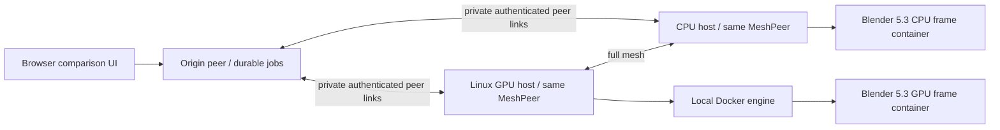

# Linux GPU render worker — prepared, not hardware-verified

**Current path:** the laptop now has verified native Iris Xe/Eevee rendering. For the two additional physical GPU servers and the current prepared-scene pipeline, use [native GPU server/network instructions](gpu-server-network.md). The Docker/Cycles setup below is the earlier separately prepared path, not a drop-in Eevee peer.

T-66 / PR #54 / ADR 0057. User selected a compatible Linux GPU worker on
2026-11-21; no such machine is currently available. The laptop remains CPU-only.
A deployment bundle is prepared; no remote host was contacted. GPU acceleration
must not be claimed until `render-probe` exits 0 on the actual worker.

## What runs where



Each Linux host uses its own Docker engine. The self-contained C# process runs
on that host and uses the same DockerWorkloadRuntime and MeshPeer as the existing
lab. There is no remote Docker TCP port, mounted Docker socket, new scheduler or
Windows game installation. The worker operator has Docker control on its own
host and access to job data; this is not confidential computing.

The current pinned preset is Linux x64 / official Blender 5.3.0. NVIDIA
CUDA/OptiX with a compatible driver and NVIDIA Container Toolkit is the first
deployment candidate, not a selected hardware purchase or a verified deployment.
HIP/oneAPI bindings remain configurable, but require appropriate runtime libraries
and device permissions and are unverified. In particular, UID 65534 must already
have access to configured Linux devices; supplementary render-group support is
not added here. Do not solve permissions by exposing all host devices.
Sources (accessed 2026-11-21):
https://docs.nvidia.com/datacenter/cloud-native/container-toolkit/latest/install-guide.html
and https://docs.blender.org/manual/en/latest/render/cycles/gpu_rendering.html .

## Prepare on the Windows development machine

From the renderer checkout:

```powershell
.\rendering\Publish-LinuxWorker.ps1
```

Output: `rendering/TestResults/linux-render-worker.tar.gz`. This contains only the
published app, scene/script, UI asset, pinned Dockerfile, launcher and example
configuration. It copies no token, credential file, private key, game or render
result. Do not add live node.json/state files to this bundle. The build needs the
.NET 8 SDK; the target Linux host does not. There is no automatic upload.

## Configure on a Linux host when one is available

Prerequisites: x64 Linux with .NET 8 native OS dependencies (libc/libgcc/OpenSSL/
zlib), Docker Engine usable by the dedicated worker operator, and compatible
GPU driver/container runtime. Driver/toolkit installation needs a host-specific
review and is deliberately not automated. Use a private machine you control.

```sh
mkdir -p digitalheat-render
cd digitalheat-render
tar -xzf /path/to/linux-render-worker.tar.gz
chmod +x start-worker.sh app/DigitalHeat.WorkloadRun
docker build -t digitalheat-landscape:5.3 -f Dockerfile .
cp node.example.json node.json
```

Build/publish one image to a registry you control only when authorised, then use
its immutable `registry/name@sha256:...` digest on EVERY peer. A bare local image
ID is not portable between classic and containerd Docker image stores. Build
arguments and package provenance should be retained with a deployment record.
The Blender archive is checksum-pinned in the Dockerfile; apt dependencies are
security-updated at build time, so separate builds are not asserted bit-identical.

Edit node.json: unique peer ID, physical_host_id, peers (including itself), actual
image digest and operator-chosen resource limits. The included heat inputs are
explicitly labelled synthetic T-66 lab settings, not measured host heat. Do not
replace scored reference-house parameters or assert measured recovered heat.

Example NVIDIA binding (replace the UUID using the target host's inventory):

```json
"gpu_backend": "CUDA",
"gpu": {
  "device_id": "globally-unique-physical-gpu-identity",
  "nvidia_device_id": "GPU-REPLACE_WITH_ACTUAL_UUID",
  "linux_devices": [],
  "read_only_binds": []
}
```

Use OPTIX only if its actual probe passes. CPU-only peers keep gpu/gpu_backend
null, but use the same image digest and scene/settings. A physical GPU may be
advertised by only one independent mesh domain. Multiple sessions on one laptop
do not become independent GPUs. No real GPU telemetry is fabricated.

Before starting network services, run:

```sh
./start-worker.sh --probe node.json
```

Exit 0: selected GPU backend completed an actual tiny Cycles render. Exit 2:
no verified GPU (including unconfigured GPU); other errors fail the command.
Probe and frame jobs use the same image, UID, isolation, resource limits and
configured GPU/device/library bindings. Each probe is bounded to 90 seconds,
then its exact owned container and anonymous volumes are removed. This is a
capability check, not a heat-controlled business job or a performance benchmark.

## Connect peers and start

The launcher pins Docker to unix:///var/run/docker.sock and clears inherited
remote-context/TLS environment overrides. It currently targets a rootful local
engine; rootless/custom-socket deployments need an explicit configuration change.
The launcher defaults to http://127.0.0.1:8080. The example has serve_ui=false;
remote workers cannot serve browser control routes. All peer APIs require the
same local-lab MESH_TOKEN, provided outside JSON/git. For cross-host connectivity,
configure private authenticated tunnels or trusted HTTPS for ALL peer URLs and
use host firewall rules restricting peer access. Do not expose plaintext token
traffic on the Internet. Certificates/tunnels are not installed automatically.
ASP.NET Core's standard Kestrel HTTPS environment settings can provide server
certificates; keep passwords outside scripts and source control.

```sh
# Set MESH_TOKEN through your operator secret mechanism, without printing it.
./start-worker.sh node.json
```

Startup repeats the same GPU probe before publishing capabilities. The scheduler
still ranks eligible nodes by heat, assigns the GPU frame class only to verified
GPU nodes, and uses ordinary CPU nodes for CPU frames. No eligible heat means
queued GPU work, not a bypass or a false CPU substitution. The approved 48-frame
mix is 38 GPU / 10 CPU frame jobs when GPU workers exist. Both comparison legs
must use matching image/settings/frame/backend assignments. The single leg pins
to one eligible GPU host; the multi leg can distribute CPU frames to other hosts.
One GPU host does not demonstrate scaling over multiple physical GPUs.

The current Docker-only laptop peers are not automatically connected to this
future host. They need the same updated image plus reviewed private reachability
and unique identities; their running comparison/games are deliberately unchanged.
Actual GPU execution, telemetry, cross-host connectivity and speedup remain
unverified until hardware is available. Package/build/CPU checks are listed in
the companion performance evidence, not presented as GPU success.


## Checked package state

The portable Blender 5.3 image built and reported CUDA/OptiX/HIP/oneAPI compiled
backends. It completed one actual CPU landscape frame (640x360, 32 samples,
seed 66) in 25.0859 render seconds, excluding container startup. This is one
loaded-laptop CPU sample, not a GPU or full-animation speed claim. Both
unconfigured and configured-but-unavailable CUDA probes correctly returned exit
2. The owned probe/validation containers were removed. Windows-built archive
extraction, chmod, shell syntax and Linux apphost execution passed. The expected
missing-config error proves apphost execution, not a running remote deployment.
88 orchestration tests passed; four focused probe regressions also passed after
removing a test-style warning. Full evidence:
[Linux worker checks](../performance/linux-render-worker-2026-11-21.json).

The final bundle includes main commit 4e363d6 (shared free-heat-share rank,
ADR 0056 by the other agent). All 88 orchestration tests passed again after
integration. Worker packaging is ADR 0057; no parallel placement policy was added.
