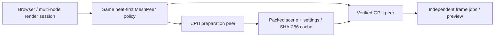

# Native multi-node renderer

T-66 / PR #54 / decisions 0058 and 0059. Current mode is **multiple nodes only**.
The user explicitly cancelled single-node/comparison execution. Render, Pause,
Resume and Stop after current frame are the only execution controls.

## Verified local path

Official portable Blender 5.3.0 rendered using **Intel Iris Xe / OpenGL** on
Windows, bypassing the Linux-container graphics translation that failed earlier.
The archive came from Blender's official release directory and matched SHA-256
`3ac567a63d59d9934f7b9213bfb27ba05760e1fb366f8f55c381573ec3eabfa8`.
No installer, Windows service, driver update or system setting change was used.
A first simple GPU render took 49.3136 s including initial shaders; the real
landscape diagnostic subsequently took 20.1044 s and 21.0870 s per frame.
These are observed render calls, not a steady-state SLA or comparison to Cycles.

Real verification passed: CPU peer `cpu` prepared one packed scene; GPU peer
`gpu` rendered two frames. Native frame-boundary pause/resume was confirmed.
The browser then ran the 48-frame configuration, completed four GPU frames,
paused after the active frame, and stopped queued work while preserving outputs.
The full 48-frame animation was NOT benchmarked to completion.

## Shared architecture



The scene builder and settings are common to Docker and native adapters.
Native workers execute our trusted Blender script through IWorkloadRuntime;
core placement has no Windows/Intel branch. Native configuration supplies the
executable, script/assets directories, graphics API, expected Blender version,
threads and whether GPU capability should be probed. Paths/bootstrap differ by
OS; shader APIs/drivers differ by GPU. A completed hardware render gates GPU
advertisement. Native Windows is verified; other native OS/hardware paths are
not yet tested. Docker remains an available adapter with its stricter mapping
and isolation. Do not invent Linux device paths for a native GPU binding.

CPU preparation is an ordinary heat-admitted job. It builds a packed procedural
scene once, without external textures/libraries. GPU jobs use the exact content
hash, recipe fingerprint, Blender build, engine/settings and frame number.
The former 38-GPU/10-CPU image split is superseded for this pipeline: CPU now
prepares the scene; ALL animation frames use Eevee for consistent appearance.
Current artifacts use a configured shared local directory. Cross-host operation
needs a shared trusted artifact store; remote transfer is not implemented.

One laptop has one physical GPU. The fixture has two logical peers sharing that
host; only `gpu` advertises the device. CPU preparation runs on `cpu` because
it has the eligible synthetic heat budget; GPU frames require GPU capability and
eligible heat. More logical peers do not create GPUs or prove physical scaling.

## Run locally

From the feature checkout (portable Blender must already be present):

```powershell
.\rendering\Start-NativeRenderLab.ps1 -BlenderExecutable C:\path\to\blender.exe
```

Default URL: http://localhost:18910/ui . The launcher prints its fresh local
configuration/log directory. `-Port` changes both loopback ports; `-Frames`
selects a smaller diagnostic animation up to the 48-frame recipe. It does not
stop an existing worker, install software or expose a public listener. No login
is required on the loopback browser UI; peer APIs use a local generated token.
Do not print or commit that token. Deployment configuration is ignored in git.

The C# worker is the same executable on supported .NET hosts:
`dotnet DigitalHeat.WorkloadRun.dll render-node /path/to/config.json`.
Set the private lab token and listener in the environment, as with the Linux
worker. Keep non-UI peers serve_ui=false. Configure native paths and a graphics
API supported by that host. Windows bootstrap is a convenience, not a scheduler
implementation. Do not claim untested OS/GPU compatibility from shared source.

## Lifecycle, privacy and performance

Native work runs as the operator account and has no Docker sandbox or enforced
RAM/CPU quota. Only our trusted generated scene/scripts are accepted; .blend
autoexec is disabled. Admission requests and measured process usage are labelled
separately. CPU percent is relative to one logical core, so >100% means multiple
cores were used (including driver/shader compilation). GPU utilization/VRAM are
unavailable without a verified sensor, even though actual GPU rendering passed.

Pause immediately holds admission, then finishes the current CPU prep/GPU frame.
The UI displays pause pending until every active job drains; pause timing starts
after drain. Stop uses that hold, fences remaining job IDs and preserves completed
images/logs. It does not stop games or Minecraft. The retired Docker comparison
project was stopped only after its attempts were held/idle; its volumes/results
remain. No single-node execution option remains in the renderer source/UI.

Native ownership is persisted before spawn; PID/start-time/executable identity
is persisted before an activation gate permits rendering. An ambiguous spawn
retains ownership and cannot relaunch automatically. Stop checks lifecycle
permission and exact process identity; native stop failure retains the claim.
Recipes are snapshotted by content hash so source edits cannot change an active
run. Registered immutable scene profiles survive worker restart. A session
restart holds the run and requires explicit resume/reconciliation.

Two observed integration defects were corrected without relaxing policy:
- Render-host inventory revisions changed every 2 s, making remote offers stale.
  Stable configured observations now renew freshness every 10 s (30 s validity),
  and messages/process exits wake the actor immediately. Heat/resource checks
  remain authoritative; full-node outcome publication remains immediate.
- The shared coordinator hard-called Docker validation for native GPU attempts.
  Common identity validation is extracted, and a runtime hook preserves strict
  Docker defaults while native validates its own trusted profile. No placement
  rank, deadline or heat formula changed.

The synthetic 300/200 kWh fixture heat and abstract case 0.8 kWh/server-hour
reservations are NOT measured laptop/recovered heat. Reference/scored numbers
are unchanged. Retained hourly commitments remain conservative for short jobs.

Sources, accessed 2026-11-21: https://download.blender.org/release/Blender5.3/ .
All timings, GPU identity and lifecycle evidence above are own local runs; see
`docs/performance/native-renderer-2026-11-21.json` for the recorded result.

Final checks: 98 orchestration tests and 51 Core tests passed. The shared scene
builder also rendered successfully in the existing Linux Docker CPU image.
Stopped native app recovery retains all four frames and freezes 94.1465 s active,
81.5245 s confirmed pause and 175.6710 s total render workflow wall time.
These are this interrupted run only, not an animation ETA or GPU speedup.
The native adapter currently permits one GPU peer per physical host; explicit
multi-adapter selection is not implemented. More physical GPU hosts can join
through configured peers/shared artifacts after their own verification.


Presentation cleanup: user keeps Minecraft and retires other game labs. PR #54 / `5d6499d` removes their executable setup, retains shared mesh/runtime and Minecraft, and shares the frontend stylesheet with the renderer (header held badge removed). Thirteen scoped containers removed without deleting volumes; only Minecraft server + Node A client remain running. 57 gaming + 98 orchestration tests and power math pass; paused native run and two frames preserved. See `docs/jobs/presentation-cleanup.md` and `docs/performance/presentation-cleanup-2026-11-21.json`. T-66 remains in progress until code PR merges.


PR #54 is now merged. See [node visualization and measured timing](render-node-visualization.md) for T-69 / PR #59; its UI change does not alter this renderer lifecycle or placement.


Speed-first follow-up: [warm renderer](warm-renderer.md), T-71 / PR #62. Tested opt-in version at localhost:18920/ui; old paused run at 18910 retained. Per-frame heat-first scheduling and pause boundaries unchanged; extra workers deferred.
