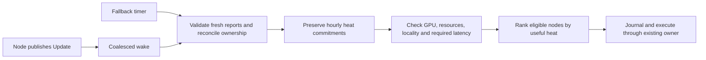

# Event-driven node updates, with heat as the placement priority

2026-11-21; T-56; ADR 0044; [PR #45](https://github.com/IllusioQuest/awkard-turtles-basel-26/pull/45).
Code branch: `feat/T-56-node-feedback`, based on main. Opt-in local prototype; not deployed to
the running gaming containers. Existing D/E/Minecraft processes were not restarted or adopted.

## What changed

Nodes can publish an **Update at any time**. An atomic snake_case JSON replacement wakes the
existing workload owner; the owner validates reports and retries waiting work through the existing
WorkloadPlacement/WorkloadCoordinator. A one-item wake channel coalesces notifications, with a
fallback timer for missed filesystem events, report expiry, reconciliation and deadline checks.
The example timer is 1 second, report lifetime at most 30 seconds, file limit 65,536 bytes and queue
limit 100 jobs. These are central operator lab limits in `config/node-feedback.example.json`, not
measured latency guarantees. Timer work executes every owner tick, including event-driven ticks.



**Heat is the ranking priority.** Gaming/streaming may specify a maximum RTT; it is a pass/fail
eligibility limit, not a lowest-latency score. If both a nearby home and a hotel meet it, the site
with more remaining useful heat wins. Batch without a latency limit is ranked by heat directly.
Existing physical GPU/resource constraints and locality remain mandatory.

- `accepting_work: false`: no new admission or resume there; retain existing games and ownership.
- A fresh heat change: reconsider waiting work within the same hour.
- Missing/expired/malformed report: fail closed for new work on that node. Missing authoritative
  site heat blocks all new placements at that site. It does not stop an active game.
- Reports do not release resources or prove a process has stopped. Only the existing reconciled
  stop/remove path releases ownership. Existing batch-first preemption remains; its preview retains
  hourly heat, so a batch is paused only if this can actually help admission.
- Zero useful heat uses the shared heat scheduler for eligible running batch pauses. Interactive
  games are never paused/moved automatically. Paused batch resumes only after re-admission, after
  waiting jobs have been considered.

## Heat semantics and worked example

Reports carrying heat must explicitly set `heat_basis: "hourly_baseline"`. Demand and tank energy
describe a baseline-equivalent budget for that fixed hourly interval. Do **not** submit current
remaining heat as though it were an untouched baseline; a future sensor adapter must perform that
translation. Hardware count, tank capacity and recoverable heat per server cannot be changed by
node feedback. One explicitly bound reporter owns each site's heat; another node cannot change it.
Readiness-only reports do not renew earlier heat observations. A heat authority should include its
valid heat signal in each complete replacement report.

Feedback mode persists a full-hour heat commitment before create/start/resume. Pausing or finishing
does not return that commitment during the hour. Current active reservations already count in the
placement engine, so the projection adds only the remainder:

`retained_extra_kwh = max(0, hourly_committed_kwh - active_owned_reservations_kwh)`

`effective_external_committed_kwh = trusted_external_committed_kwh + retained_extra_kwh`

Synthetic example (not measured game heat): an hourly baseline has 3 kWh useful capacity and a job
commits 0.8 kWh. While active, the existing reservation leaves 2.2 kWh; no extra commitment is added.
After release, retained_extra is 0.8 kWh, so 2.2 kWh remains. Ten repeated Updates still leave 2.2,
not a new 3 kWh budget per notification. A valid change to the baseline may change capacity, but
does not erase that 0.8 kWh commitment. A new hour retires the previous hour's budget; ongoing jobs
commit again before new admission. This is intentionally conservative for short jobs, pauses,
created-but-unstarted attempts and uncertain starts. It is a reservation policy, not measured heat
delivery or elapsed-runtime energy integration. Yearly/scored simulation is unchanged.

## Code map

| File | Responsibility |
|---|---|
| `src/DigitalHeat.Orchestration/NodeFeedback.cs` | Shared report/policy, authority/freshness/sequence validation, atomic local publishing, persistent accepted reports, inventory projection |
| `src/DigitalHeat.Orchestration/NodeFeedbackOwner.cs` | Bounded filesystem wake and serialized fleet tick, immutable submissions, existing admission/reconciliation/deadlines |
| `src/DigitalHeat.Orchestration/WorkloadCoordinator.cs` | Opt-in durable hourly commitments and dispatch-time freshness, existing ownership/actuation retained |
| `src/DigitalHeat.WorkloadRun/Program.cs` | `watch-feedback` and `publish-feedback` commands; operator status/cleanup access |
| `config/node-feedback.example.json` | Sourced lab limits and example heat-authority bindings; adapt bindings to the real fleet |
| `src/DigitalHeat.Orchestration.Tests/NodeFeedbackTests.cs` | Deterministic behavioral tests plus real temporary-filesystem notification check |

## Running it

Use a separately configured fleet, with valid existing workload/runtime profiles and sourced heat
and resource requirements. No game auto-start is enabled by this documentation: CS/Minecraft heat
measurement and compatible GPU/physical occupancy gates still apply. Never substitute synthetic
fixture heat for a real-game measurement.

Prepare a policy from the example with exactly one trusted reporter per site. The example bindings
`home -> a`, `spa -> b` are illustrative inventory identities, not automatic discovery of gaming D/E.
The finite manifest, deadlines, runtime endpoints and policy stay immutable while the owner runs.
The operator may atomically refresh inventory with an increasing revision, including the next hour;
feedback does not extend resource/GPU telemetry expiry. Without a fresh next-hour inventory, new
admissions stop while deadline enforcement continues.

```powershell
dotnet run --project src/DigitalHeat.WorkloadRun -- watch-feedback <fleet.json> <state-directory> <inbox-directory> <policy.json>
dotnet run --project src/DigitalHeat.WorkloadRun -- publish-feedback <inbox-directory> <node-report.json>
```

Create a report with these snake_case fields:

| Field | Meaning |
|---|---|
| `node_id` | Exact configured node identity; filename is `node-<id>.json` |
| `sequence` | Positive monotonic counter, persisted by publisher across restart; never reset |
| `observed_at_utc`, `valid_until_utc` | Actual UTC observation and bounded expiry; no future observation |
| `interval_start_utc` | Exact UTC start of the trusted current hourly interval |
| `accepting_work` | Whether the node can accept new work; false means full/unavailable |
| `heat` | Optional existing HeatSignal: demand_kwh, tank_stored_kwh, tank_capacity_kwh, server_count, recoverable_kwh_per_server_at_full_load |
| `heat_basis` | `hourly_baseline` when supplying heat; no incremental heat credits |
| `source` | Measurement/parameter provenance and reproducible method; do not invent sensor data |

Publish by complete atomic replacement using the CLI or `NodeFeedbackInbox.Publish`. Increasing
the sequence alone does not freshen an old timestamp. Duplicates preserve original expiry;
old/conflicting sequences fail closed. Publisher restarts must preserve the sequence. Owner restart
restores accepted reports and heat commitments. A replay cannot erase a full report or renew heat.
Full report deletion is not an availability notification: it disables admission until a fresh report.

Use a new explicit state directory/fleet when opting into retained accounting; an existing journal
cannot silently change accounting mode. Do not delete or replace another fleet's journal. One
owner holds the existing per-fleet lock. Ctrl+C stops the owner, **not** its jobs. After stopping it,
ordinary `status`, `pause`, `stop` and cold backup commands recognize retained accounting; manual
`start/resume/heat/watch-deadlines` cannot bypass the feedback path for that journal.

## Verification and performance

```powershell
dotnet test src/DigitalHeat.Orchestration.Tests
dotnet test src/DigitalHeat.Core.Tests
dotnet build src/DigitalHeat.WorkloadRun
```

58 orchestration tests and 46 Core tests pass; WorkloadRun builds without warnings/errors. Tests
cover full/heat updates within one hour, heat ranking among latency-eligible nodes, restart/replay,
paused/released heat retention, useful batch-pause preview, malformed feedback with deadline stop,
expiry during create, early filesystem wake and a burst of 10,000 bounded wake hints. An actual
CLI publication into a separate temporary inbox produced one node-probe.json and no leftover
temporary file. No runtime actions or Docker game changes in that experiment.

Unchanged diagnostic command from the T-47/PR #36 harness:

```powershell
& <performance-checkout>\scripts\Measure-SchedulerPerformance.ps1 -SourceRoot <T-56-checkout> -OutputPath <report.json>
```

Raw evidence: `docs/performance/scheduler-node-feedback-2026-11-21.json`, source 49d9448.
Later commits change CLI operator access, a test and authority validation, not placement source.
Harness SHA256 `1a03b75cd3363dd9efdeace64a3a49de64db7d51ff8ae811aeac3e061ff22133`;
Release .NET 8.0.31, tiering disabled, 20 warmups/101 samples, nearest-rank p95.

| Pure reservation fixture, no held claims | Median ms | p95 ms |
|---|---:|---:|
| 3 nodes, independent domains | 0.0073 | 0.0265 |
| 1,024 nodes, shared domain | 0.9381 | 1.7863 |

Read report microseconds / 1000 as milliseconds. The earlier lab threshold for the latter fixture
was max(2 * 2.5228, 2.5228 + 1) = 5.0456 ms; this run is below it. A non-dedicated laptop's
load varies, so do not claim a causal speedup or guaranteed p95. This diagnostic does not time
the new event-owner scan, Docker operations, real GPU admission or streaming. Filesystem tests
establish early waking before a 30-second fallback, not an end-to-end response SLA.

## Boundaries and coordination

This is a **trusted local-file transport**, not a remotely authenticated node API. Folder access
grants authority to report; no container socket, new HTTP port, library or monitoring write access
was added. A node-side sensor/heartbeat agent and a secured remote adapter remain future work.
Reports are a complete latest state, not an append-only distributed queue. Jobs come from a fixed
finite manifest; dynamic submissions require a separate admission design.

Synchronous Docker calls can delay the serialized owner. Feedback arriving during one is applied
on the next tick; current-clock expiry is rechecked before dispatch/resume. Deadline checks run
before report/config processing and between admissions; malformed input blocks admission but not
those checks. An uncertain runtime failure still retains claims and may require operator recovery.
There is no hard real-time or HA owner claim.

T-54 LiveGrid already reschedules between ticks; its queue, network scheduler and UI were left
untouched. No duplicate network scheduler was built. Shared Core physics, WorkloadPlacement heat
ranking, scored yearly figures, read-only monitoring and existing game deployments remain intact.
