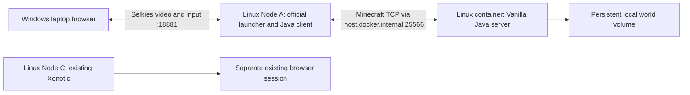

# Minecraft server and browser client lab (T-44)

Status: implemented locally on `feat/T-44-minecraft-server`, dependent on T-43 / PR #33.
User requested testing before pushing/merging to main. This guide and the current code remain
local pending that test. Nothing here claims verified authenticated gameplay or useful heat.

## What runs where



The client renders the game and the server simulates the shared world in different containers.
These containers currently share one Docker Desktop engine/laptop: this demonstrates component
separation, not physical-server redundancy or splitting one world's simulation across servers.
Client and server need separate capacity reservations when admitted in the universal runtime.
This calibration lab has no heat-based admission until measurement evidence is valid.

## Test now

1. Open http://localhost:18881 and use the existing local gaming desktop `player` credentials.
   Do not confuse these with the Microsoft account used inside Minecraft.
2. The official Minecraft launcher is running on Node A. Sign in yourself with the Microsoft
   account that owns Java Edition. No password/token should be sent to an agent or committed.
3. Choose **Minecraft Java 26.3** (not Bedrock or a snapshot), install/play inside the Linux desktop.
   The launcher downloads the client and matching runtime; no native laptop game install is needed.
4. In Minecraft choose **Multiplayer > Direct Connection**, address
   **`host.docker.internal:25566`**. `localhost` inside this client would mean the client container.
5. Explore and place blocks. Disconnect before requesting a restart/persistence test.

The Windows-native client address would be `localhost:25566`; this is a game TCP address, not a
web page. Browser rendering, account entitlement, downloaded-client compatibility and performance
remain user checks. The launcher's process/window and client-to-server TCP reachability have been
observed, but these are not proof that a player joined. First account login/download needs internet.

## Reproduction

Run in the Minecraft task checkout in PowerShell:

```powershell
.\gaming\scripts\Build-Minecraft.ps1
.\gaming\scripts\Start-MinecraftCalibration.ps1 -AcceptEula -CalibrationOnly
.\gaming\scripts\Prepare-MinecraftClient.ps1
.\gaming\scripts\Start-MinecraftClient.ps1
# After every player disconnects:
.\gaming\scripts\Stop-MinecraftCalibration.ps1
.\gaming\scripts\Test-MinecraftWorldSave.ps1
.\gaming\scripts\Test-MinecraftPersistence.ps1 -AcceptEula
```

The client preparation reuses existing Selkies Node A and its persistent home; it does not install
Windows software, change package-manager state, alter game code or touch Xonotic on Node C.
It verifies a locally recorded SHA-256 of the official launcher archive before extraction, refuses
changed upstream bytes and leaves an identical installed/running launcher alone. Future launches
use the existing generic C# desktop runtime and its desktop locks with a separate application profile.
The initial manual smoke launch preceded that wrapper. Dispatch acknowledgment is not readiness.
Microsoft login and game downloads are interactive user actions. Keep the Node A home private:
it may contain account tokens. Do not clone it to other users/nodes or include it in world backups.
Node operators can access plaintext account/session data; this is not confidential computing.

Server artifact/runtime pins, heap/CPU/RAM lab settings and measurement policy live in
`gaming/minecraft/server.json`; launcher URL/hash/node live in `client.json`; the desktop application
profile is `client-runtime.json`. The official launcher self-updates: its initial archive pin does
not claim reproducibility of authenticated downloads or subsequent launcher updates.

## Persistence and shutdown evidence

The CPU-only server runs non-root with online authentication, RCON disabled, loopback exposure,
2 CPU quota, 3072 MiB container memory and 512/2048 MiB initial/maximum JVM heap. These are lab
settings, not measured throughput or heat claims. EULA consent is explicit on each launch command.
One world is pinned to one node/local volume; no active-world migration, sharding or HA is claimed.

Stopping forwards `stop` to Minecraft's console, then checks current-boot player/world/dimension
save logs, successful non-OOM Java exit and matching per-boot exit evidence. An earlier direct
SIGTERM trial exited 143 without save proof and was rejected. Calibration temporarily disables
empty-server auto-pause; the wrapper restores the previous setting on exit or next startup after
interruption. The old lab's persisted -1 was explicitly restored to its previously observed default
60 before verifying this fix. Active players block test stop unless disconnection is explicitly allowed.

Verified locally on 2026-11-21: Java 26.3 status readiness; same-volume restart; cold archive into a
labelled backup volume; restore to a fresh volume; restored-server readiness and clean save;
original server restarted on port 25566. Source, backup and restored volumes were retained.
The backup helpers mount only these labelled volumes, with narrowly needed ownership/read
capabilities and no host mounts/network. No user world was deleted. The final image was
`sha256:4c6d0a7db44785870ad558f5cbb153d650a1745935c4a6ba76433cc7296f4b90`.

## Measurement: rejected, heat startup blocked

The user requires measurement before heat-based startup and rejected the case's abstract server
heat assumption. The battery trial measured no valid Minecraft power or useful-heat figure.
WMI discharge rate was the invalid sentinel -2147483648. The implemented alternative samples
WinRT `RemainingCapacityInMilliwattHours`, requiring continuous unplugged discharge.

Procedure: 45 s baseline, 30 s server warmup, 90 s idle/no-player server window, 30 s cooldown,
45 s post-baseline; nominal 1 s samples. Other activity must remain steady. Fit remaining capacity
in mWh against elapsed seconds: `power_w = -slope_mwh_per_second * 3.6`. Interpolate the two
baseline means at the loaded-window midpoint; subtract from loaded power. Acceptance requires
positive window power and positive incremental power above the maximum of 1 W, twice baseline
drift and twice the regression-residual power bound. No CPU-percent-to-watts conversion is used.

Actual ignored evidence: `gaming/TestResults/minecraft/power-20261121-084149/measurement.json`
and adjacent three raw JSONL windows. Before/load/after slopes gave approximately
24.54/14.25/0 W; the post-baseline had no battery-capacity update. The computed 2.87 W difference
was below the 49.07 W rejection threshold. It is **not measured Minecraft power**. Coarse/stale
battery updates make this trial inconclusive; reported drift does not prove a physical load change.
The policy description originally said standard deviation; it was corrected to describe the
already executed regression-residual calculation without changing raw samples or numeric results.

`Measure-MinecraftBattery.ps1 -RunCalibration -AcceptEula` prepares another explicit trial, but
repeating the same coarse sensor may not help. No new trial runs automatically. Export recomputes
raw samples, checks policy/duration/workload/engine identity and rejects a forged acceptance flag.
Even accepted incremental electrical power would require a separately reviewed recovery model
or measured useful-heat evidence; no recovery fraction is defaulted. Current scheduled-profile
export remains blocked. Calibration is separate from the shared scheduler, solely to obtain evidence.

## Checks and sources

Passed: 36 gaming tests, 29 orchestration tests, Minecraft PowerShell parse checks, power-math/raw
recomputation/tamper guards, missing-EULA/invalid-heap/rejected-measurement guards, live readiness,
idle-setting restoration and persistence/restore checks. Docker build succeeds with two required
base-image-ARG lint warnings. Authenticated/browser Minecraft gameplay is still pending user testing.

Sources accessed 2026-11-21:

- [Official launcher downloads](https://www.minecraft.net/en-us/download)
- [Official Java server download](https://www.minecraft.net/en-us/download/server)
- [EULA](https://www.minecraft.net/en-us/eula), explicitly accepted by the user for this demo
- [Mojang version manifest](https://piston-meta.mojang.com/mc/game/version_manifest_v2.json), exact metadata/artifact hashes recorded in server.json
- [Temurin containers](https://adoptium.net/installation/containers), image digests recorded in server.json
- [WinRT capacity units](https://learn.microsoft.com/en-us/uwp/api/windows.devices.power.batteryreport.remainingcapacityinmilliwatthours)

Downloaded jars, launcher, worlds, credentials, account caches and raw runtime evidence stay outside
git. Test evidence and build cache are in ignored `gaming/TestResults`, worlds in Docker volumes.
