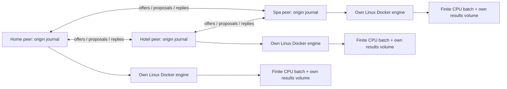

# Unified heat-first scheduler and Linux peer mesh

Implementation: PR #52, branch `feat/T-60-unified-scheduler`. Decisions 0049–0051;
tickets T-60/T-62/T-64/T-65. This supersedes the policy-selection part of Jona's
ADR 0048. The selected-site admission boundary remains in use.

## One policy, several execution adapters

Core owns these rules:

1. Pending jobs use earliest deadline, then stable ordinal job ID (`JobPriority`).
2. Eligibility excludes insufficient resources, forbidden locations, stale capacity,
   expired deadlines and, where required, unsuitable latency. Lower RTT is not a ranking bonus.
3. Eligible sites rank by remaining useful heat, then ordinal site/node ID (`HeatPlacementRank`).
4. `HeatFirstScheduler` derives load from the same `HeatCapacity` used by placement.

The adapter names are not selectable policies: Network represents hourly cohorts/filler;
Fleet represents event-driven chunks; Orchestration represents owned Linux containers.
They retain their existing work ledgers and physical/runtime interfaces. No new physics or
economics model was introduced. Core's minimum-load parameter remains an explicit physical
constraint: a nonzero mandatory minimum can dump heat. The reference and mesh use zero for
interruptible work. New container admission always requires positive sufficient useful heat.

Removed implementations/modes: Network B0, B1, B2, B1/B2 reserve, rolling-horizon LP schedulers,
the Fleet mock scheduler with urgency overriding heat, and run-and-dump job execution.
Only `mesh-heat-first` is selectable. Old mode IDs fail explicitly. Analytical LP bounds and
historical research files remain evidence, not executable alternative scheduler modes.
Historical experiment commands selecting retired modes must be migrated deliberately; they
must not silently generate new figures under old labels.

## Heat and lifecycle accounting

For an hourly signal:

`remaining_useful_heat_kwh = max(0, demand_kwh + tank_capacity_kwh - tank_stored_kwh - committed_heat_kwh)`.

The lossless storage formula is the existing Core/case model. Example: demand 8 kWh, no tank,
two admitted 0.4 kWh/h jobs gives 7.2 kWh remaining for this hour. This example is a synthetic
lab signal, not a measurement of the laptop or water heating.

Mesh uses the existing coordinator's retained hourly commitments. Completion, stop or pause
does not reopen that heat budget. A node can send an update at any time; its new demand/capacity
is applied while admitted commitments remain. Hour boundaries use a new interval. A paused
container releases CPU admission capacity but retains RAM, GPU and slot claims. A stale selected
offer is rechecked against the target's raw revision; internal retained-budget revisions are
mapped separately rather than causing a false mismatch.

Fleet initializes an admission budget once per hour from its physically settled demand/tank.
It retains the maximum heat claim of each admitted chunk in that hour, including completed or
paused chunks. Repeated events do not reset it. Actual production and recovered/dumped heat
are still integrated by Fleet's existing engine; do not subtract that actual energy again from
an already reserved full-hour claim. This conservative admission model can underuse capacity
for short chunks. A subsequent hour resets claims and reserves continuing work first.

No useful heat means no new batch/urgent start. Interruptible running batch pauses when useful
heat disappears. Noninterruptible interactive work and checkpoint overhead can continue; their
power occupies capacity and their heat, including surplus, remains in the physical balances.
Games are not moved or restarted automatically. Deadlines order pending work and exclude new
expired starts. Existing live-job expiry/stop rules remain in the coordinator; Fleet's deadline
statistics and lifecycle belong to its event engine, not a new promised live-service SLA.

## Decentralized ownership



Every origin durably records a job intent before proposing execution. Every target rechecks
admission and records its outcome before replying. A lost/unknown reply retries the same target;
it never authorizes another peer to start a replacement. Rejection tombstones prevent delayed
old proposals from starting after replanning. Origin failure waits for origin recovery. There is
no leader, global queue, replicated ownership consensus or automatic origin reassignment.

Heat priority means maximum heat **among the fresh eligible offers currently known to the
origin**, not instantaneous knowledge of every remote update. New offers wake planning, but do
not migrate an already accepted active job. Full-mesh dissemination is O(n²); three-peer lab
success is not evidence of Internet-scale mesh performance.

## Linux lab and reproduction

Windows runs Docker Desktop and the operator PowerShell commands. All peers, inner engines
and jobs run Linux. Three privileged DinD peers have distinct persistent engine/state volumes.
They share the laptop's physical CPU and Docker Desktop VM; they are quota slices, not three
independent physical servers or GPUs. Privileged DinD is approved trusted lab infrastructure,
not production tenant isolation. No outer Docker socket, host home, host networking or Docker
TCP listener is used. `/run` is temporary so stale containerd PID files cannot break recovery.

The private internal network does not provide working host-port publication in this Docker
Desktop setup. Operator requests use scoped `docker exec` into a peer and its internal HTTP
API. Peer messages use built-in ASP.NET Core/HttpClient, snake_case JSON and a shared lab token.
The token stays in ignored local files/environment. It identifies trusted lab membership, not
cryptographically distinct peer identities. No remote commands/images/environment files can
be submitted: the API starts only the locally configured finite batch profile.

Run from the feature checkout:

```powershell
.\mesh\Start-MeshLab.ps1
.\mesh\Invoke-MeshRequest.ps1 -Peer home
.\mesh\Test-MeshLab.ps1
.\mesh\Test-CreateRecovery.ps1
```

The last two commands perform deliberate mesh-only failure experiments; do not run concurrently.
The ordinary test restarts the origin while a remote batch is paused; the create-recovery test
temporarily disables admissions on the other peers, injects a bounded post-create delay on spa,
and restarts spa before acknowledgement. They never target gaming or Minecraft containers.

`mesh/TestResults/` holds ignored credentials, generated configs, binaries, archives and raw lab
reports. Named volumes retain journals and per-job results. Do not prune them to fix a recovery
problem. The existing games remain separate runtime owners and are not adopted by the mesh.

The Ising workload reuses `jobs/research-sim/ising.py` (ADR 0020), one worker, two finite passes,
16×16 lattice, 100,000 sweeps, 2,000 thermalisation sweeps, one temperature/seed, fixed seed
20251115. Parameters are a reproducible runtime fixture, not measured service demand. Each job
has its own persistent `/work`; the image digest determines its profile ID. Outer peers are capped
at 0.75 CPU/1024 MiB, advertise 0.5 CPU/256 MiB/two slots, and admit jobs of 0.25 CPU/128 MiB.
The 0.4 kWh/job-hour heat assumption is case 0.8 kWh/server-hour × 0.25/0.5 CPU share, explicitly
synthetic, not a measurement. The 600-second budget is the approved experimental research-job
target in `config/live-job-deadlines.json`, not a proven SLA.

## Verification and migration boundaries

Tests cover exact unlimited reference-year hourly equality, finite and mixed single-site load/
deadline equivalence, heat-first remote preference, sovereignty/latency gates, deterministic ties,
stale/competing offers, duplicate/lost replies, origin recovery, retained heat and active-game
protection. Fleet checks include no-heat urgent refusal, same-hour repeated events, checkpoint
capacity, noninterruptible continuation and tick/event agreement.

These checks do not establish arbitrary heterogeneous workload/price equivalence between every
legacy model. T-61's wider cross-model/economic validation remains separate. Multi-site flows
and Fleet outcomes intentionally differ from the retired policies. Never relabel historical
B2/LP results or claim old performance/financial figures were regenerated automatically.

See `docs/performance/` for separate pure-placement, durable in-process protocol and Fleet
timings. Runtime Docker/HTTP/failure evidence is recorded separately from those microbenchmarks.
