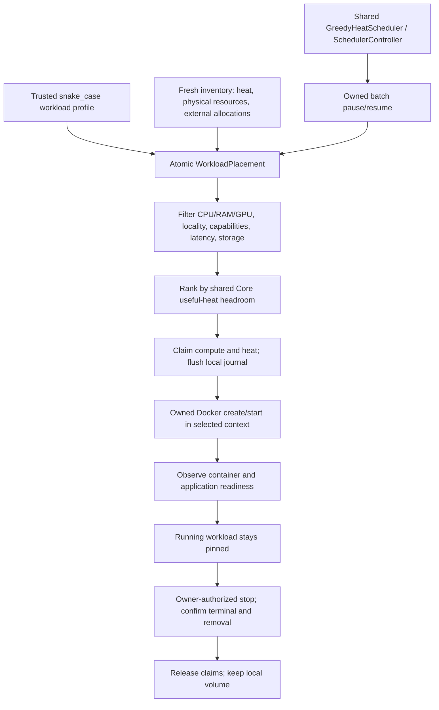

# Universal workload placement: first executable prototype (T-43)

The same admission engine now handles legacy gaming reservations and explicit CPU/RAM/GPU
workloads. C# and Docker contexts remain the stack; no Kubernetes/Ray package was added. It
distributes whole processes/containers, not arbitrary instructions inside an unchanged game.
The first proof uses the existing Xonotic profile and an isolated real batch/interactive probe.

## How it works



`SessionPlacement` is now a compatibility adapter to `WorkloadPlacement`. Its existing public
contracts and all gaming/monitor behavior remain tested. Legacy calls declare session slots and
heat only: they do not suddenly acquire CPU/RAM/GPU isolation guarantees. Resource-aware users
use the new workload API. Core heat physics, economics, yearly inputs and network simulation
models remain unchanged.

## Profiles, units and limits

| Input | Meaning |
|---|---|
| `cpu_cores` | CPU-equivalent quota budget, not dedicated/pinned physical cores |
| `ram_mib` | Declared RAM budget; Docker applies a memory limit, including OOM behavior |
| `slots` | Application concurrency, e.g. one desktop at a time |
| `gpu_capability` | Required capability on one exclusive declared physical GPU |
| `min_gpu_vram_mib` | Optional minimum VRAM; missing/insufficient GPU memory blocks admission |
| `recoverable_heat_kwh_per_hour` | Positive sourced estimate or explicitly labelled assumption |
| `resource_source`, `heat_source` | Provenance; unresolved `TODO(source)` does not authorize admission |
| placement policy | Existing customer-authorized locality guard, `JobPlacement.IsEligible` |
| latency limits | Per-peer maximum RTT in ms; unknown observation fails closed |
| pinned node / storage ID | Local data stays at the configured node; no implicit copying |
| lifecycle | Owner-authorized pause/stop; restart declaration does not enable automatic restart |

One `ResourceDomain` represents a physical resource pool. Nodes sharing the laptop must share
that domain and GPU identity. Capacity is checked at both node and domain levels. External
allocations exclude owned claim IDs; observed owned processes are not subtracted twice. One
Docker context cannot be configured as several independent physical domains. Context aliases or
separate engines on the same hardware still require correct operator-supplied physical identity.
This prototype does not automatically discover a trustworthy physical topology or measure heat.

Hourly heat intervals and shorter resource observation/expiry timestamps are both required for
new resource admissions. Old/missing resource telemetry blocks new claims/resumes; existing
claims stay held. CPU utilization is not free reserved capacity. The inventory is a trusted
operator input, not synthesized from a low CPU/RAM usage sample.

New requests go to the eligible site with greatest absolute useful-heat headroom, then stable
site/node ID ties. This uses `HeatCapacity.RemainingKwh`, not another heat formula. For the
July scenario: spa demand 7.2893 + empty tank 245 = 252.2893 kWh. A protected external 0.8 kWh
claim leaves 251.4893; admitting a 0.05 kWh synthetic batch leaves 251.4393. These are case/profile
assumptions, not a measurement of the laptop or an actual hotel.

Pausing an authorized batch releases its CPU budget and model heat, **retaining RAM, GPU and
slots**. The coordinator first checks whether pausing can help; it does not pause healthy work
for a request blocked by retained memory/GPU. It validates runtime profiles/local images first.
Games cannot take the batch pause path. Releasing memory/GPU requires confirmed termination;
checkpointing and automatic relocation are not implemented.

## Running the offline planner

From the T-43 checkout (or main after integration):

```powershell
dotnet run --project src/DigitalHeat.WorkloadRun -c Release -- example . gaming/TestResults/protected-plan.json 2025-07-15T18:00
dotnet run --project src/DigitalHeat.WorkloadRun -c Release -- plan gaming/TestResults/protected-plan.json 2025-07-15T17:00:00Z
```

The example reads `config/network/switzerland-test.json` through the existing loader. Weather
and case/profile data are reused; building sizes/tanks and operator compute budgets remain
labelled scenarios. The fixed UTC+1 conversion follows the committed 2025 dataset SOURCE file,
not summer civil time. The example represents current A/B/C desktop allocations externally;
the existing Xonotic GPU is protected, so a second exclusive GPU request is blocked.

For a clearly labelled planner-only comparison, choose a new output file:

```powershell
dotnet run --project src/DigitalHeat.WorkloadRun -c Release -- example . gaming/TestResults/unoccupied-plan.json 2025-07-15T18:00 --unoccupied-simulation
dotnet run --project src/DigitalHeat.WorkloadRun -c Release -- plan gaming/TestResults/unoccupied-plan.json 2025-07-15T17:00:00Z
```

This removes the external C claim **from the model only**. It does not stop the game, free a GPU
or authorize running two games on it. Both sample files are historical plan inputs; actual start
uses the real clock and rejects their expired interval. Do not merely edit timestamps to bypass
freshness: obtain current trusted heat/resource/external-allocation inputs first.

## Real local runtime proof

```powershell
powershell -NoProfile -ExecutionPolicy Bypass -File scripts/Test-WorkloadRuntime.ps1
```

Requires an existing local Alpine-compatible image (`alpine:3.22`, or `-Image`). It never pulls
images. It resolves the exact cached image ID, creates random-fleet, network-disabled, non-root
workloads with small quotas, and invokes the real CLI across separate processes (journal recovery).
It checks heat-based placement, idempotent start, the shared yearly/live heat-control path,
pause/resume, CPU admission while paused RAM remains held, observed stop/removal/release, and
cold backup/restore of a private user-owned file. The interactive probe is `sleep`, not a claim
that an additional Xonotic stream was launched.

Evidence/config/journal remain under ignored `gaming/TestResults/dhw-smoke-*`. Cleanup removes
only that random fleet's containers and its exact temporary volumes. No global prune, user data,
image deletion or existing game/desktop stop. The current game was still PID 403 after tests.

## Operating your own configured workloads

```powershell
dotnet run --project src/DigitalHeat.WorkloadRun -c Release -- start <fresh-config.json> <state-directory> <workload-id>
dotnet run --project src/DigitalHeat.WorkloadRun -c Release -- status <config.json> <state-directory>
dotnet run --project src/DigitalHeat.WorkloadRun -c Release -- heat <fresh-config.json> <state-directory> <batch-id>
dotnet run --project src/DigitalHeat.WorkloadRun -c Release -- pause <config.json> <state-directory> <batch-id>
dotnet run --project src/DigitalHeat.WorkloadRun -c Release -- resume <fresh-config.json> <state-directory> <batch-id>
dotnet run --project src/DigitalHeat.WorkloadRun -c Release -- stop <config.json> <state-directory> <workload-id>
```

This is an operator CLI, not a continuously running telemetry/heat-watch daemon. Refresh trusted
inventory and invoke heat control when inputs change. `heat` uses shared `GreedyHeatScheduler`,
`SchedulerController.Apply` and `DockerJobExecutor`; it never applies batch pause to a game.
Start automatically pauses authorized batch work only if it can make the interactive request fit.

Images must be cached on the selected engine (`--pull never`). Pin image IDs/digests in real
config for reproducibility; example tags are editable starting points. CPU/RAM and shared-memory
limits are applied to workload-owned containers, with dropped capabilities and no-new-privileges.
Ports are loopback-only; no Docker socket is passed to a workload. GPU bindings support explicit
NVIDIA device selection or the reviewed Linux/WSL device/read-only driver mappings. Whole-device
exclusivity is cooperative admission accounting, not a GPU security boundary against external
programs. Network latency/capacity, storage space and runtime performance still need measurements.

The Xonotic template uses the existing local image, browser port 18884, a separate local home,
correct working directory/audio environment, startup lock and an executable-identity readiness
probe. It requires a private `gaming/TestResults/workload-xonotic.env`, including existing Selkies
authentication, CPU-H264 and Intel driver settings. Do not put passwords into JSON or commands.
It is a launch template, **not a newly gameplay-tested stream**. The current GPU remains occupied;
do not launch this profile until the old game has ended naturally or another eligible GPU/node
is available. NVIDIA and remote-engine execution were not tested on the Intel laptop.

## Crash behavior and local persistence

Use one trusted coordinator host/OS operator for a fleet. A stable per-fleet OS file lock prevents
two local instances, including two journal directories under that operator's temp root. A flushed
JSON journal is written before create/start/stop intent. Deterministic names and fleet/attempt/
spec labels scope every mutation, and CPU/RAM limit drift blocks control.

Restart reconciles labelled containers before admission. Unknown owned containers, uncertain
missing starts or identity mismatches block new work while keeping claims. A confirmed created,
unstarted container can continue once or be explicitly cancelled. A start timeout never triggers
blind duplicate launch. Released IDs are tombstones, not reusable workload names. Preserve the
journal and config; journal loss is not repaired by guessing ownership.

This is **not HA or cross-host fencing**. Do not run competing controllers under different hosts/
OS users, delete a lock/journal to bypass uncertainty, or edit labels. Active workloads can continue
without the CLI, but its own state disk remains a dependency. Operator reconciliation is required
for lost containers/engine failures; no seamless migration or automatic recreation is promised.

For a released workload's claimed local volume:

```powershell
dotnet run --project src/DigitalHeat.WorkloadRun -c Release -- backup <config> <state-dir> <id> <storage-id> <backup-volume> <archive.tar.gz> <cached-tool-image>
dotnet run --project src/DigitalHeat.WorkloadRun -c Release -- restore-empty <config> <state-dir> <id> <storage-id> <backup-volume> <archive.tar.gz> <cached-tool-image> <new-volume>
```

No live-world snapshot is attempted: stop/release first, then verify no running/paused container
uses the volume. Backups cannot select another storage ID from the node. Restore requires an
absent, fleet-namespaced destination (`DockerWorkloadRuntime.VolumePrefix(fleetId)`), never an
existing volume. Backup source and restore archive mounts are read-only. A small isolated root
helper gets DAC_OVERRIDE to read private owned data; restore additionally gets CHOWN/FOWNER to
preserve application UID/GID. Its root filesystem is read-only, networking disabled and no host
directory is mounted. Use trusted locally created archives. Update the future node/storage binding
explicitly after restoration; restoration is not live failover or geographic replication.

## Code map and verification

- `src/DigitalHeat.Orchestration/WorkloadModels.cs`: unit-named requirements/inventory/claims.
- `WorkloadPlacement.cs`: atomic resource and shared heat admission; paused-resource accounting.
- `WorkloadCoordinator.cs`: journal, local lock, ownership reconciliation and lifecycle.
- `ContainerRuntime.cs`: scoped Docker limits, device/volume bindings, readiness and batch control.
- `LocalVolumeBackup.cs`: cold local backups and new-volume restores.
- `src/DigitalHeat.WorkloadRun`: CLI and sourced historical example builder.
- `gaming/src/DigitalHeat.Gaming/SessionPlacement.cs`: compatibility adapter; same admission engine.
- `src/DigitalHeat.Orchestration.Tests`: resource/concurrency/crash/ownership/backup tests.

The gaming Visual Studio solution includes these projects. New architecture adds no third-party
package. Independent code review found and corrected preflight-before-preemption, recovery of
created containers, and backup storage authorization; ADR 0033 records the design review.

Verified: real Docker smoke and private-file backup/restore pass; 29 orchestration tests, existing
36 gaming tests, 46 Core and 20 Network tests; Release solution build. See T-43 for final PR and
integration status. Minecraft installation/world sharding, replicated storage, checkpointing,
automatic migration, GPU sharing and controller HA are outside this first approved milestone.
